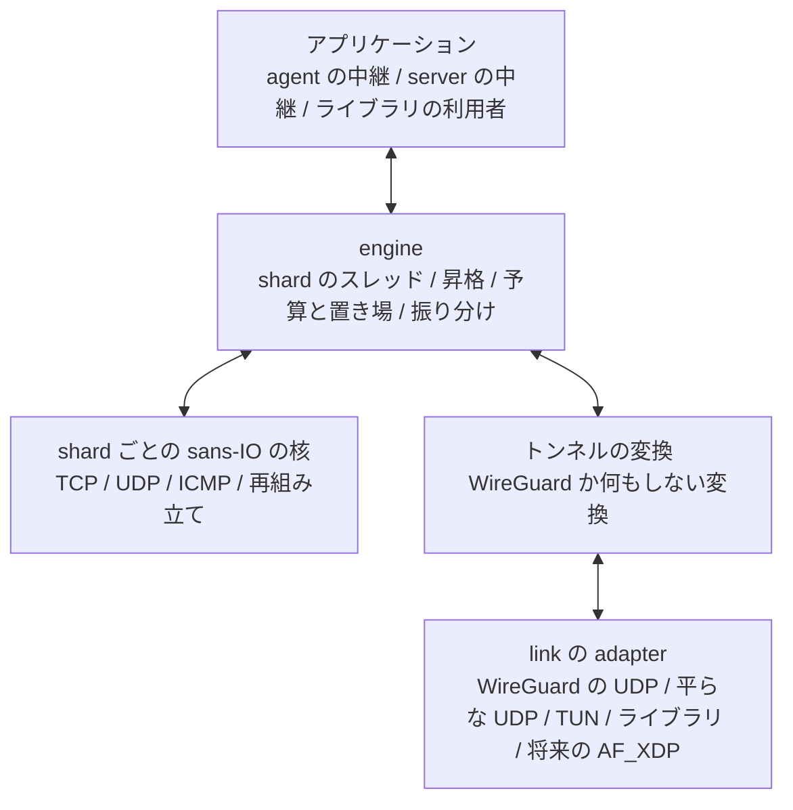
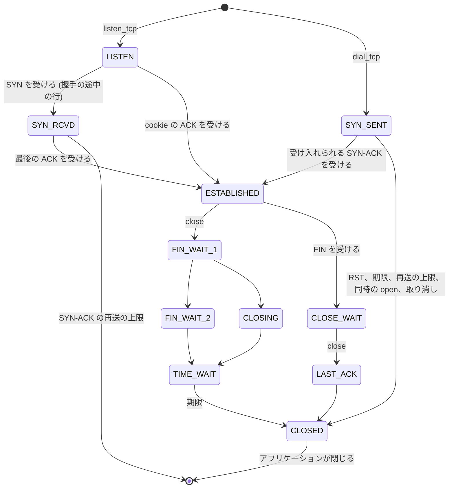

# API の境界 (N5)

この文書は、推奨の構成 S の、protocol と I/O に依らない API の境界を定めます。
shard ごとの sans-IO の核、engine、link の adapter、トンネルの変換、アプリケーションの API、受動と能動の open に共通の TCP の状態の模型を扱います。
未実装の dial は、並列の構成に依らない TCP の仕様として整理し、この提案では製品に実装しません。
未採用の提案です([提案の索引](README.md))。

## 層の分け方

- 核は I/O、スレッド、時計、乱数を持たず、今と同じく `&mut` で呼ぶ値です
- engine はスレッド、昇格、予算と置き場、link と変換の駆動を持ちます
- 変換は link の datagram と核の IPv4 packet の間を変えます
- link は外の世界との datagram の受け渡しだけを持ちます

## shard ごとの sans-IO の核

核は今の `Stack` の API ([sans-IO の API](../../v2/wgstack-rs.md#sans-io-の-api)) を保ち、次を加えます。

| 加えるもの | 中身 |
|---|---|
| shard の文脈 | 作成の時に shard の番号と N を受け、IP ID の間隔と乱数の種を決めます。N = 1 では今と同じ値です |
| 入口の判定 | 4 つ組を引いて、自分で処理するか、どの shard の持ち主へ渡すかを返します。今の入口の検索の結果を使い、2 回引きません |
| 接続を渡す | 昇格する接続を自分の list から外し、状態を値として返し、自分の枠を昇格した印の枠にします |
| 接続を受ける | 渡された状態を自分の枠に入れ、list につなぎ、タイマーを張り直します |
| 接続を返す | TIME_WAIT の行の中身か解放を返し、shard 0 の核が行を入れて昇格した印の枠を空きに戻します |
| 予算の credit | 全体の予算を直接持たず、engine が渡す credit から借ります |

核の型は、shard 0 の核と、昇格した接続だけを持つ核で同じです。
昇格した接続だけを持つ核は、接続の枠を P 本にし、待ち受け、握手の途中、TIME_WAIT の表、再組み立ての表の容量を 0 にして作ります。
どの核もほかの核とメモリを共有せず、今と同じく `unsafe`、錠、atomic を持ちません。
今の核はすでに握手の途中の表の容量 0 を受け付けます([dial の側を足す継ぎ目](../../v2/wgstack-rs.md#dial-の側を足す継ぎ目))。

## engine

engine は、核、変換、link を組み合わせて動かす値です。

- 作成:設定 (アドレス、上限、MTU) と link と変換を受け、起動の時の CPU の数から N を決めます。
  N の設定は持ちません
- N = 1:Inline の駆動の経路をそのまま使います。
  N が 2 以上の経路とは別の関数にし、N = 1 の経路に輪と atomic と申し出の判定を置きません(設計判断)
- スレッド:N が 2 以上の時、shard 1 から N-1 のスレッドを作成の時に作り、スタックの大きさを明示します
- 停止:engine を閉じると全 shard を止め、予算と置き場を返します。
  今の `close` と同じく、次の世代に予算を渡せます
- 実行環境:各 shard は自分の event loop を持ちます。
  agent では今と同じく tokio の current-thread の実行環境を shard ごとに持ち、中継の task はその接続の持ち主の shard で動きます

## link の adapter

link の adapter は、datagram のバッチの受け渡しと、その能力を示します。

| 能力 | 意味 |
|---|---|
| queue の数 | 受ける queue の数。最初の試作は 1 だけを扱います |
| queue の振り分け | queue が 1 つか、flow の hash で分けた複数か。複数なら hash の関数を公開するか |
| まとめた受け渡し | 1 回の呼び出しで複数の datagram を受け渡せるか (`recvmmsg`、`sendmmsg`) |
| 結合と分割 | 受信の結合と送信の分割 (UDP の GRO と GSO) を持つか |
| 枠の持ち主 | 受けた枠が engine の置き場のものか、link が貸すもの (AF_XDP の UMEM) か |
| 最大の datagram | 受け渡す datagram の最大の大きさ |

| adapter | 中身 | 段階 |
|---|---|---|
| WireGuard の UDP | 今の外側の UDP のソケットとバッチ | 最初から |
| 平らな UDP | 暗号の無い UDP で IPv4 packet を運びます。試験と、暗号を別に持つ利用者のためです | 試作の P2 で使います |
| TUN | TUN の device の IPv4 packet を読み書きします | 汎用のスタックとしての利用で加えます |
| ライブラリの直接の呼び出し | アプリケーションが packet を渡し、packet を受け取ります。sans-IO の試験と、ほかの I/O を持つ利用者のためです | 試作の P0 で使います |
| AF_XDP | NIC の queue の UMEM の枠を貸し借りします | 将来の候補で、作るかは未決です |

借りた枠の規則は、所有者の写しの方針に従います([バッチの作りの規則](../../v2/agent-throughput.md#バッチの作りの規則))。

- 短く終わる処理 (header の読み、復号、checksum) は link の枠を借用します
- 長く持つデータ (読まれていない TCP のデータ、順序外のデータ、再送のデータ、実行の区切りをまたぐ UDP の中身) は、予算のある置き場に写して枠を返します
- link が貸す枠 (AF_XDP の UMEM) も同じ規則で、核が写した後すぐに返します

TAP は L2 の header と近隣の解決を要し、核は IPv4 の L3 だけを扱うので、この提案の範囲に入れません。

## トンネルの変換

変換は、受信と送信をそれぞれ 3 つに分けた形を持ちます。

| 段 | 受信 | 送信 | 呼ぶ所 |
|---|---|---|---|
| 始め | datagram を分類し、replay の前の確かめをし、鍵の写しを持つ仕事を作ります | counter を予約し、鍵の写しを持つ仕事を作ります | 状態を持つ段。セッションの錠の下 |
| 本体 | 復号します | 暗号化します | 状態を持たない段。どのスレッドでも動きます |
| 終わり | replay を確定し、endpoint を更新します | 無し | 状態を持つ段。セッションの錠の下 |

制御の仕事 (ハンドシェイク、cookie、keepalive、鍵の交換、タイマー) は、変換の状態を持つ段の口として、セッションの役 (shard 0) が呼びます。

WireGuard の変換は sanstun の分けた API (`begin_decapsulate`、`PendingDecapsulate::decrypt`、`commit_decapsulate`、`begin_encapsulate`、`PendingEncapsulate::encrypt`) で作ります。
N = 1 の時は、今の `Device::handle_datagram` と `Device::handle_packet` の 1 回の呼び出しの形を使います。
分けた API の費用 (worker の無い 2 vCPU の送る 1 stream で byte あたりの CPU 1.027 倍、測定) を、N = 1 の経路に入れないためです(設計判断)。

何もしない変換は、大きさ 0 の型で、始めと終わりは何もせず、本体は link の枠をそのまま平文として借用させます。
engine は変換を型の引数で受けるので、何もしない変換の時は、申し出の板、セッションの錠、平文の置き場への復号を作らず、その分の費用を払いません(設計判断)。
何もしない変換では暗号の分担が無くなるので、並列は昇格だけで得ます。

## アプリケーションの API

### 接続の識別

| 識別子 | 中身 |
|---|---|
| `ConnId` | shard 0 の枠の番号と 64 bit の世代。今と同じで、shard の番号を含みません |
| `ListenerId`、`UdpId` | ポートと 32 bit の世代。今と同じです |
| `PingId` | 今と同じです |

`ConnId` は shard 0 の枠を指し、昇格の後もその枠は昇格した印を持って残るので、昇格しても識別子は変わりません。
ライブラリの利用者の操作は shard 0 に届き、shard 0 は枠が昇格した印を持てば、移し先の shard に回します。

### 操作の届け方

- agent と server の中継:中継の task は接続の持ち主の shard の上で動き、今の handle の層 (`wgft-netstack`) を通して自分の shard の核を同じスレッドで呼びます。
  昇格の時は、中継の task を止めて状態を移し、移し先で始め直します
- ライブラリの利用者:アプリケーションのスレッドは shard の外にあるので、engine は操作を持ち主の shard の命令の輪に載せ、結果と知らせを利用者の側の輪で返す口を持ちます。
  利用者が 1 つのスレッドで accept する時は、engine が shard 0 の accept の待ち行列から返します

### TCP の API

今の操作 (`listen_tcp`、`accept`、`close_listener`、`read`、`write`、`close_write`、`close_conn`、`close_for_delivery`、`abort`、`delivered`、`local_addr`、`peer_addr`) を保ち、dial のために次を加えます。

| 加えるもの | 中身 |
|---|---|
| `dial_tcp(now, remote, local, deadline)` | 能動の open を始め、`ConnId` を返します。完了は知らせで届きます |
| `Event::Connected(ConnId)` | 確立した知らせです |
| `Event::ConnectFailed(ConnId, reason)` | 拒否、期限、再送の上限、同時の open、ポートの不足のどれかで失敗した知らせです |
| `abort` の SYN-SENT での意味 | 取り消しです。RST を送らずに枠を返します |

### UDP と ping

UDP と ping の今の操作を保ちます。
接続した UDP のための口 (endpoint の鍵をポートと任意の相手の組にすること、`WaitReadable`、Port Unreachable での終わり) は、[UDP の接続したセッション](../../userspace/wgstack-dial.md#udp-の接続したセッション)の決定に従います。

## 受動と能動の open に共通の TCP の状態の模型

| 項目 | 受動の open | 能動の open | 共通の扱い |
|---|---|---|---|
| 置き場 | 握手の途中の行か cookie、確立で枠へ | SYN を送る時から枠 | 確立の後は同じ枠の状態機械です |
| 確立の入口 | 握手の途中の行か cookie から交渉した値の組を作ります | SYN-ACK から交渉した値の組を作ります | 交渉した値の組 (MSS、窓の scale、SACK、timestamp、両方の ISN、timestamp の値) から 1 つの確立の処理を通ります |
| 接続の識別 | 4 つ組と `ConnId` | 同じ | 同じ |
| ISN と timestamp の offset | 4 つ組の鍵つきの hash | 同じ | 向きに依りません |
| ポート | 待ち受けのポート | 一時ポート | 4 つ組は接続、握手の途中、SYN-SENT、TIME_WAIT のどれとも衝突しません |
| 再送 | SYN-ACK の再送の list | SYN の再送のタイマー | 確立の後は RTO、RACK、TLP で同じです |
| 取り消し | 待ち受けを閉じると握手の途中の行に RST を送ります | `abort` で RST を送らずに枠を返します | |
| 期限 | SYN-ACK の再送の上限 | 呼び出し側の期限か再送の上限 | |
| 閉じ方 | 同じ | 同じ | FIN、TIME_WAIT、RST の規則は今と同じです |

## TCP の能動の open

dial の仕様は、並列の構成に依らない TCP の仕様です。
[wgstack の dial の側](../../userspace/wgstack-dial.md)の決定をそのまま使い、要点とこの提案で変える点を次に挙げます。

### 使い続ける決定

- SYN-SENT の置き場:接続の枠に置きます。
  K に数えない dial のために、K の外に小さな固定の枠を置きます
- ポート:RFC 6056 の乱数を使う選び方で選び、4 つ組の衝突を確かめます。
  尽きたら誤りを返し、数えて 1 分に 1 回までログに出します
- SYN の再送:最初の RTO は 1 秒で、再送ごとに倍にします。
  呼び出し側の期限か再送の上限で失敗します。
  SYN を再送した接続の初期の輻輳の窓は 1 segment です
- SYN-SENT の入力:RFC 9293 3.10.7.3 に従います。
  ICMP の誤りは接続を終えない柔らかい誤りです
- 同時の open:持ちません。
  SYN-SENT で ACK の無い SYN を受けたら dial を失敗させます (知った上での違い)
- client の option:SYN に MSS、SACK-permitted、timestamp、窓の scale を載せ、SYN-ACK で使うかを決めます
- 誤りの約束:拒否、期限、確立の後の RST、相手の FIN の後の読み取りを見分けられる誤りを返します
- 接続した UDP とエージェントごとの上限:接続した UDP のセッションと、多くのエージェントで 1 つの Device を分け合う時のエージェントごとの上限は、dial の側の文書の決定のままです

### この提案で変える点

| 点 | dial の側の文書 | この提案 |
|---|---|---|
| 実装の置き場 | Go の `internal/wgstack` の名前で書かれています | v2 の Rust の核 (`crates/wgft-wgstack`) に置きます。規則は変えません |
| 誤りの形 | Go の `errors.Is` と `net.Error` で書かれています | 核は誤りの種類 (拒否、期限、リセット、終わり、ポートの不足、同時の open) を返し、言語ごとの形への写しは handle の層が持ちます |
| 実行する shard | 並列を前提にしていません | dial は shard 0 の核で行い、確立の後に昇格しえます。4 つ組の衝突の確かめは shard 0 の表で完結するので、規則は変わりません |
| 接続した UDP の鍵 | 待ち受けのポートと任意の相手の組 | 同じ鍵を、UDP のセッションの昇格に使えるようにします。昇格させるかは未決です |
| 確立の入口 | 交渉した値の組から始める形に分けると決めています | 受動と能動の確立は shard 0 の核の同じ入口を通ります。昇格は確立の後に行うので、昇格した接続だけを持つ核はこの入口を使いません |

dial の側の文書の「実装の時に決めること」(一時ポートの幅、TIME_WAIT の 4 つ組の自分の側での使い直し、SYN の再送の回数の上限、疎通確認の枠の数、UDP の chunk の単位と予算、server の Device の表の大きさ) は、この提案でも実装の時に決めます。

## 製品の build に入れないもの

- 決定的に shard の交互の順を作る試験の実行器、loom の模型、fuzz の口は、`cfg` か feature で製品の build から外します([正しさの試験](verification.md#正しさの試験))
- 段ごとの時間の分布と queue の深さの計測器は、ラボの計測の feature を付けた build だけに入れます
- 製品の build に入るのは、ログの 1 分の門と既存の数えと同じ種類の数えだけです

[提案の索引](README.md)
