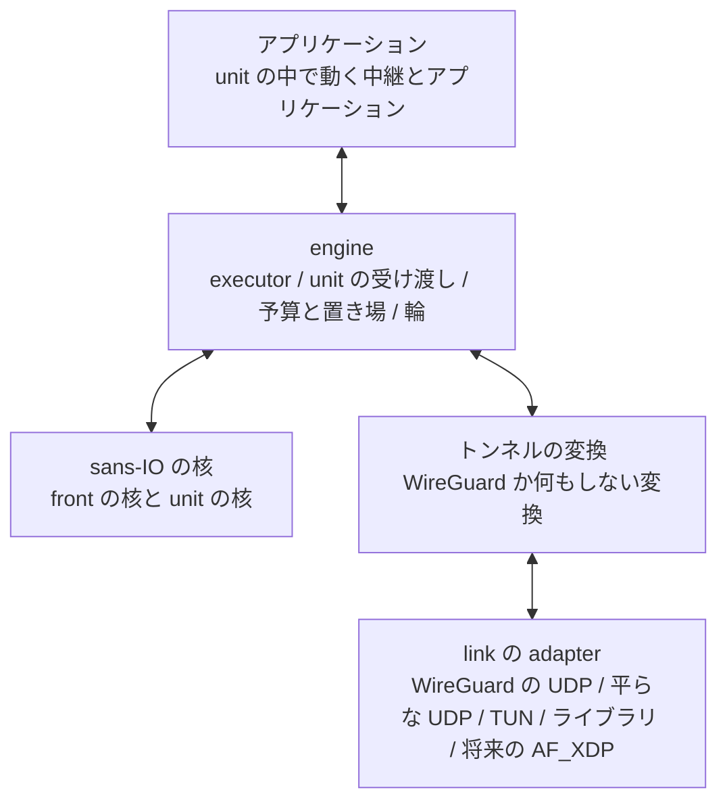
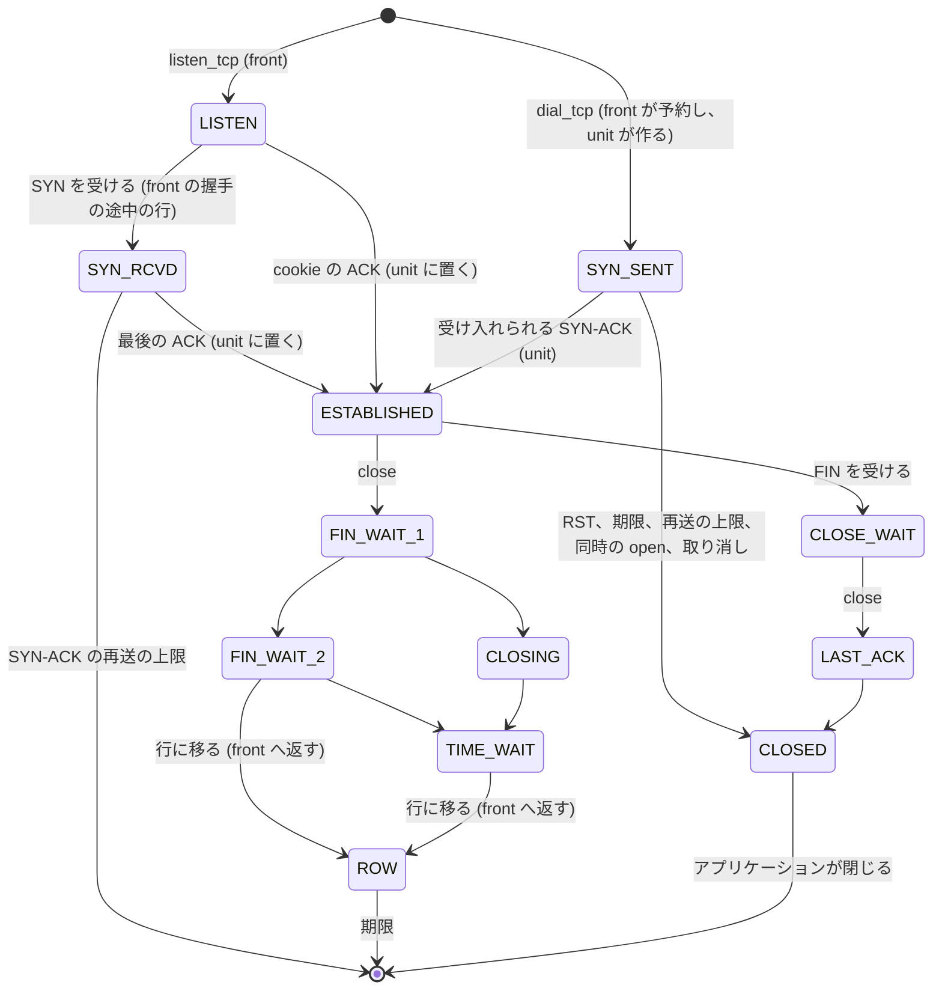

# API の境界 (N5)

この文書は、推奨の構成 U の、protocol と I/O に依らない API の境界を定めます。
sans-IO の核、engine、link の adapter、トンネルの変換、アプリケーションの API、受動と能動の open に共通の TCP の状態の模型を扱います。
未実装の dial は、並列の構成に依らない TCP の仕様として整理し、この提案では製品に実装しません。
未採用の提案です([提案の索引](README.md))。

## 層の分け方

- 核は I/O、スレッド、時計、乱数、錠、atomic を持たず、今と同じく `&mut` で呼ぶ値です
- engine は executor、unit の受け渡し、予算と置き場、輪、link と変換の駆動を持ちます
- 変換は link の datagram と核の IPv4 packet の間を変えます
- link は外の世界との datagram の受け渡しだけを持ちます

## sans-IO の核

核を、front の核と unit の核に分けます([核の作り直し](memory.md#核の作り直し))。
どちらも今の `Stack` の API ([sans-IO の API](../../v2/wgstack-rs.md#sans-io-の-api)) の形を保ちます。
利用できる CPU が 1 つの時は、今の核をそのまま使います。

| 核 | 持つもの | 加える口 |
|---|---|---|
| front の核 | 4 つ組の表、待ち受け、accept の待ち行列、握手の途中、TIME_WAIT と FIN_WAIT_2 の行、再組み立て、UDP、ICMP | 入口の判定 (表の項が unit の接続を指す時、処理せずに (unit、枠、世代) を返します)、握手の最後で確立する代わりに交渉した値の組を返す口、dial の予約、返却の知らせ (表から外す、行を入れる、枠の解放) を受ける口、戻された SYN を受ける口 |
| unit の核 | 自分の枠の数の接続の枠、タイマーの輪、出力の list、制御の輪 | 交渉した値の組と最後の ACK から確立する口、dial の SYN-SENT を作る口、表から外す時と行に移る時と枠を返す時に返却の知らせを出す口、SYN を戻す口、credit から借りる口 |

unit の核は、65,536 行のポートの表を持ちません。
今の核の型は待ち受けと UDP の endpoint の表を必ず確保するので、型を分けるか、表を作成の時の引数にする作り直しが要ります。

## engine

- 作成:設定 (アドレス、上限、MTU) と link と変換を受け、起動の時の利用できる CPU の数から helper の数と unit の数を決めます。
  設定は持ちません([CPU の数ごとの動かし方](performance.md#cpu-の数ごとの動かし方))
- 利用できる CPU が 1 つ:今の核をそのまま使い、front だけの executor で動きます。
  unit の輪と atomic を経路に置きません(設計判断)
- executor:front のスレッドと helper のスレッドです。
  データプレーンの executor は tokio を使わず、executor ごとの poller で動きます([unit の epoll](ownership.md#unit-の-epoll))
- 停止:engine を閉じると全 executor を止め、予算と置き場を返します。
  今の `close` と同じく、次の世代に予算を渡せます
- データプレーン:推奨は、tokio を使わない executor のデータプレーンを全 OS で 1 つにする形です。
  Windows と macOS と、利用できる CPU が 1 つの Linux は、front だけの executor で動きます。
  front だけの時は unit の受け渡しが無いので、IOCP で poller を付け替えられないことが問題になりません。
  今の tokio のデータプレーンを残して 2 つを持ち続けるかは、所有者が決めます([所有者に決めてもらうこと](README.md#所有者に決めてもらうこと))
- 複数の CPU:helper を使う経路は Linux だけで作ります

## link の adapter

| 能力 | 意味 |
|---|---|
| queue の数 | 受ける queue の数。最初の試作は 1 だけを扱います |
| まとめた受け渡し | 1 回の呼び出しで複数の datagram を受け渡せるか (`recvmmsg`、`sendmmsg`) |
| 結合と分割 | 受信の結合と送信の分割 (UDP の GRO と GSO) を持つか |
| 枠の持ち主 | 受けた枠が engine の置き場のものか、link が貸すもの (AF_XDP の UMEM) か |
| 最大の datagram | 受け渡す datagram の最大の大きさ |

| adapter | 中身 | 段階 |
|---|---|---|
| WireGuard の UDP | 今の外側の UDP のソケットとバッチ | 最初から |
| 平らな UDP | 暗号の無い UDP で IPv4 packet を運びます。試験のためです | 試作の P2 |
| TUN | TUN の device の IPv4 packet を読み書きします | 汎用のスタックとしての利用で加えます |
| ライブラリの直接の呼び出し | アプリケーションが packet を渡し、packet を受け取ります | 試作の P0 |
| AF_XDP | NIC の queue の UMEM の枠を貸し借りします | 将来の候補で、作るかは未決です |

借りた枠の規則は、所有者の写しの方針に従います([バッチの作りの規則](../../v2/agent-throughput.md#バッチの作りの規則))。
短く終わる処理は link の枠を借用し、長く持つデータは予算のある置き場に写します。
link が貸す枠は、スレッドをまたぐ前に平文の block に写します。
TAP は L2 の header と近隣の解決を要し、核は IPv4 の L3 だけを扱うので、範囲に入れません。

## トンネルの変換

| 向き | 呼ぶ所 | 形 |
|---|---|---|
| 受信 | front | 今の `Device::handle_datagram` の 1 回の呼び出し |
| 送信 (front が実行する unit と UDP) | front | 今の `Device::handle_packet` の 1 回の呼び出し |
| counter の在庫の補充 | front | device の層に加える口で、`begin_encapsulate` を在庫の分だけ呼び、`PendingEncapsulate` と endpoint の世代を返します。セッションが無ければ、`handle_packet` と同じくデータによるハンドシェイクの開始を行います |
| 送信 (helper が実行する unit) | helper | 在庫の `PendingEncapsulate::encrypt` で暗号化します。経路は接続を置く時に front が確かめ、MTU は核が MSS で守るので、packet ごとには確かめません。送った数は front が集めます([counter の在庫](ownership.md#counter-の在庫)) |
| 制御 | front | ハンドシェイク、cookie、keepalive、鍵の交換、タイマー |

sanstun は変えません。
使う口はどれも sanstun の公開の API です。
`PendingEncapsulate` の欄は `Zeroizing` の鍵、index、`u64` だけなので、スレッドの間で渡せます (sanstun のコードの読み)。

何もしない変換は大きさ 0 の型で、受信は link の枠をそのまま平文として借用させ、counter の在庫を作りません。
engine は変換を型の引数で受けるので、何もしない変換の時は counter の在庫と暗号の呼び出しを作らず、その費用を払いません(設計判断)。

## アプリケーションの API

### アプリケーションの置き場

アプリケーションは、接続の unit の中で、その unit を実行する executor の上で動きます。
agent の中継はこの形の最初のアプリケーションです。
アプリケーションは今と同じ核の操作を同じスレッドで呼ぶので、スレッドをまたぐ読み書きはありません。
engine が接続ごとにアプリケーションを作る口、LAN の側の I/O とタイマーを unit の epoll から受ける口、dial を unit から front へ求めて完了を受ける道は、骨格だけを決め、形は P0 で決めます([未決の項目](verification.md#未決の項目))。

外のスレッドから接続を読み書きするライブラリの API (データを持つ命令と結果をスレッドの間で渡す形) は、P0 から P3 の範囲の外にします([所有者に決めてもらうこと](README.md#所有者に決めてもらうこと))。
1 つのスレッドで使う汎用の sans-IO の TCP/IP スタックとしては、今の核をそのまま使えます。

### 接続の識別

| 識別子 | 中身 |
|---|---|
| `ConnId` | unit の番号、その unit の枠の番号、64 bit の世代 |
| `ListenerId`、`UdpId`、`PingId` | 今と同じです |

接続は作成の後に unit を移らないので、`ConnId` に unit の番号を含めます。
利用できる CPU が 1 つの時の unit の番号は常に 0 です。

### TCP の API

今の操作 (`listen_tcp`、`accept`、`close_listener`、`read`、`write`、`close_write`、`close_conn`、`close_for_delivery`、`abort`、`delivered`、`local_addr`、`peer_addr`) を保ち、dial のために次を加えます。

| 加えるもの | 中身 |
|---|---|
| `dial_tcp(now, remote, local, deadline)` | 能動の open を求めます。unit のアプリケーションが呼び、求めは front へ渡り、front が一時ポートを選んで同じ unit に接続を作ります。`ConnId` と完了は、その unit の知らせで届きます |
| `Event::Connected(ConnId)` | 確立した知らせです |
| `Event::ConnectFailed(ConnId, reason)` | 拒否、期限、再送の上限、同時の open、ポートの不足のどれかで失敗した知らせです |
| `abort` の SYN-SENT での意味 | 取り消しです。RST を送らずに枠を返します |

accept は front で行い、accept した接続のアプリケーションは、その接続の unit で始めます。

### UDP と ping

UDP と ping の今の操作を保ちます。
接続した UDP のための口は、[UDP の接続したセッション](../../userspace/wgstack-dial.md#udp-の接続したセッション)の決定に従います。

## 受動と能動の open に共通の TCP の状態の模型

| 項目 | 受動の open | 能動の open | 共通の扱い |
|---|---|---|---|
| 置き場 | 握手の途中の行か cookie (front)、確立で unit の枠へ | SYN を送る時から unit の枠 | 確立の後は同じ枠の状態機械です |
| 確立の入口 | front が交渉した値の組を作り、unit に渡します | unit が SYN-ACK から交渉した値の組を作ります | 交渉した値の組から 1 つの確立の処理を通ります |
| ISN と timestamp の offset | 4 つ組の鍵つきの hash | 同じ | 向きに依りません |
| ポート | 待ち受けのポート | front が選ぶ一時ポート | 4 つ組は front の表で、接続、握手の途中、SYN-SENT、行のどれとも衝突しません |
| 再送 | SYN-ACK の再送 (front) | SYN の再送 (unit) | 確立の後は RTO、RACK、TLP で同じです |
| 取り消し | 待ち受けを閉じると握手の途中の行に RST を送り、accept の前の接続の終わりを unit に求めます | `abort` で RST を送らずに枠を返します | |
| 期限 | SYN-ACK の再送の上限 | 呼び出し側の期限か再送の上限 | |
| 閉じ方 | 同じ | 同じ | FIN と RST の規則は今と同じで、FIN_WAIT_2 と TIME_WAIT の行は front に返します |

## TCP の能動の open

dial の仕様は、並列の構成に依らない TCP の仕様です。
[wgstack の dial の側](../../userspace/wgstack-dial.md)の決定をそのまま使い、要点とこの提案で変える点を次に挙げます。

### 使い続ける決定

- SYN-SENT の置き場:接続の枠に置きます。
  K に数えない dial のために、K の外に小さな固定の枠を置きます
- ポート:RFC 6056 の乱数を使う選び方で選び、4 つ組の衝突を確かめます。
  尽きたら誤りを返し、数えて 1 分に 1 回までログに出します
- SYN の再送:最初の RTO は 1 秒で、再送ごとに倍にします。
  SYN を再送した接続の初期の輻輳の窓は 1 segment です
- SYN-SENT の入力:RFC 9293 3.10.7.3 に従います。
  ICMP の誤りは接続を終えない柔らかい誤りです
- 同時の open:持ちません (知った上での違い)
- client の option:SYN に MSS、SACK-permitted、timestamp、窓の scale を載せ、SYN-ACK で使うかを決めます
- 誤りの約束:拒否、期限、確立の後の RST、相手の FIN の後の読み取りを見分けられる誤りを返します
- 接続した UDP とエージェントごとの上限:dial の側の文書の決定のままです

### この提案で変える点

| 点 | dial の側の文書 | この提案 |
|---|---|---|
| 実装の置き場 | Go の `internal/wgstack` の名前で書かれています | v2 の Rust の核 (`crates/wgft-wgstack`) に置きます。規則は変えません |
| 誤りの形 | Go の `errors.Is` と `net.Error` で書かれています | 核は誤りの種類を返し、言語ごとの形への写しは handle の層が持ちます |
| 予約と作成 | 1 つの核の中で行います | front が一時ポートを選んで表に項を入れ、unit が SYN-SENT を作ります。衝突の確かめは front の表で完結します |
| 確立の入口 | 交渉した値の組から始める形に分けると決めています | 受動の open も同じ入口を unit で使います |
| 取り消し | 枠を返し、RST を送りません | unit が枠を返し、返却の知らせで front が表の項を外します。後から届いた SYN-ACK は表に項が無いので、front が RST を返します |

dial の側の文書の「実装の時に決めること」は、この提案でも実装の時に決めます。

## 製品の build に入れないもの

- 決定的に executor の交互の順を作る試験の実行器、メモリの順の模型の検査、fuzz の口は、`cfg` か feature で製品の build から外します([正しさの試験](verification.md#正しさの試験))
- 段ごとの時間の分布と輪の深さの計測器は、ラボの計測の feature を付けた build だけに入れます
- 製品の build に入るのは、ログの 1 分の門と既存の数えと同じ種類の数えだけです

[提案の索引](README.md)
