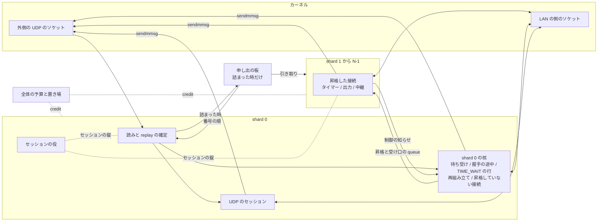
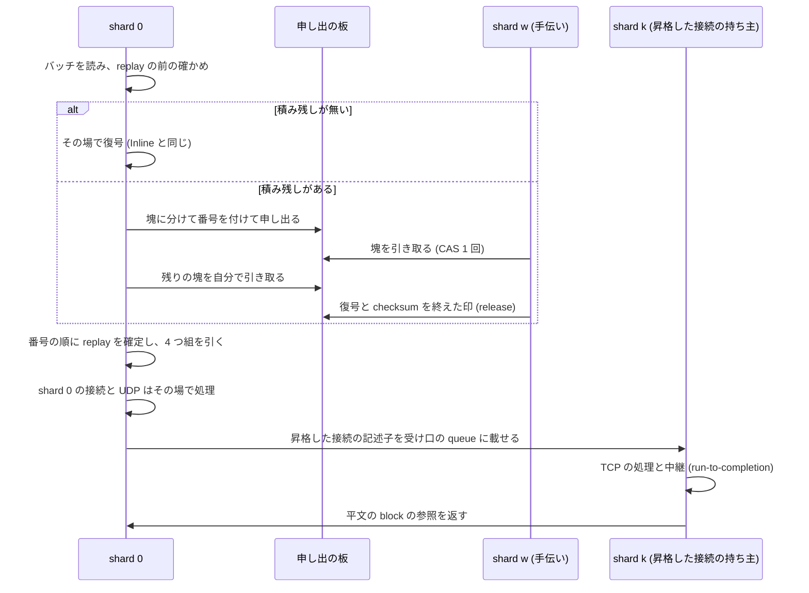
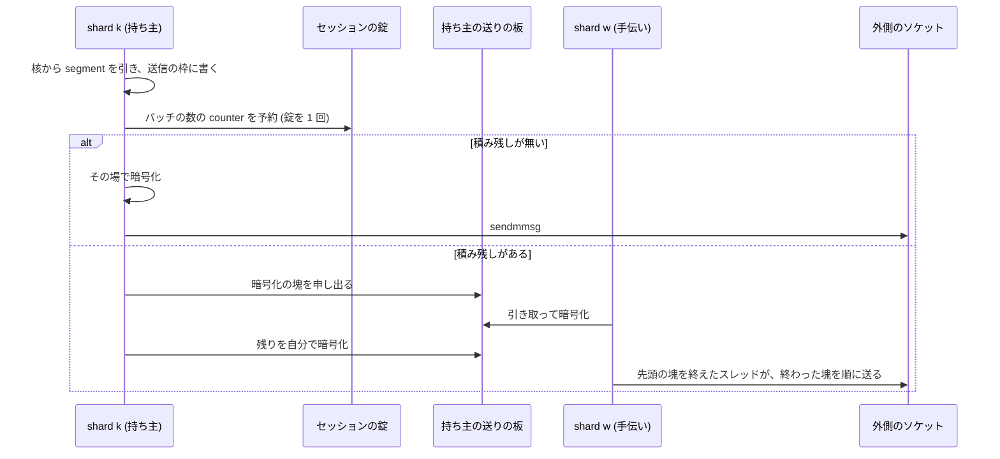

# 所有と同期の設計 (N2)

この文書は、推奨の構成 S で、状態ごとの持ち主、受ける向きと送る向きのデータの流れ、状態の移り、同期の点とその頻度を定めます。
未採用の提案です([提案の索引](README.md))。
構成を選んだ理由は[構成の比較](architecture.md#推奨の構成-s)にあります。

## 所有の全体図

shard 0 は今の Inline のデータプレーンのスレッドの仕事をすべて持ち、加えて振り分け、セッションの役、接続を作る表を持ちます。
shard 1 から N-1 は、昇格を受けた TCP の接続の持ち主と、暗号の手伝いです。
N = 1 の時は shard 0 だけがあり、図の queue と申し出の板は作りません。

## 状態の置き場の原則

- 各 shard の核は、今と同じく自分の状態だけを `&mut` で持つ値で、ほかの shard と共有するメモリを持ちません。
  核の中に `unsafe`、錠、atomic を入れない今の規則を保つためです(設計判断)
- shard 0 の核は、今の核と同じく N_c 本の接続の枠、4 つ組の表、待ち受けの表、握手の途中の表、TIME_WAIT の表、再組み立ての表を持ちます
- shard k の核は、昇格した接続を入れる P 本の枠と、自分のタイマーの輪、出力の list、知らせの list を持ちます。
  P は起動の時に決める固定の数で、初めの値は 128 です(設計判断、試作で決めます)
- 昇格は、接続の状態を値として shard 0 から k へ移します。
  枠の構造体 (TCB と付帯の値、約 1.4 KiB) は写し、記録の輪、区間の表、受信と送信の輪の chunk の表、chunk は所有を移すだけで写しません
- shard 0 の枠は、昇格の後も「昇格した印」(移し先の shard と世代) を持つ空の枠として残ります。
  4 つ組の表はこの枠を指したままなので、shard 0 は今の入口の検索だけで振り分け先を知ります。
  枠の数 N_c の内に昇格した接続も数えられるので、接続の上限の判定も今のままです

## 昇格

昇格は、shard 0 の TCP の接続 1 本を、shard k へ一方向に移す手順です。
shard 0 が詰まっていない間は起きません。

### 昇格の条件

- 詰まりの判定:shard 0 は、すでにバッチごとに読む時刻から、窓 (仮の値は 100 ms) の中の仕事の時間の割合を求めます。
  割合が上の線を続けて超えた時に、詰まりとします
- 選ぶ接続:窓の中で最も多くの byte を運んだ接続です。
  packet ごとに今の最大と比べて 1 つだけ覚えるので、走査をしません
- 確立の時の昇格:詰まりの間に確立した接続は、accept の直後に昇格させます。
  接続の入れ替わりが多い負荷を shard 0 から外すためです
- 移し先:公開された負荷の数が最も小さい shard です。
  P 本の枠が埋まった shard には移しません。
  shard 0 は shard ごとの昇格と返却を自分で数えるので、空きを知るのに同期は要りません
- 速さの上限:昇格は窓ごとに 1 本までにします
- 条件の外:昇格させない接続は、accept の前の接続、shard 0 が暗号化の塊を申し出ていて送り終えていない接続、閉じる途中の接続です

線と窓の値は試作で決めます。
昇格した接続を shard 0 に戻すことはしません(設計判断)。
戻しを持たないことで、持ち主が変わるのは shard 0 から k への 1 回だけになり、順の論証が単純になります。

### 昇格の手順

1. shard 0 は、受信と送信のバッチの間で、選んだ枠 i を自分のタイマーの輪、出力の list、知らせの list、段の保有者の list から外します
2. shard 0 は、枠 i の中継の task を止め、LAN の側のソケットと中継のバッファの中身を取り出します
3. shard 0 は、枠 i の状態を昇格の知らせ (状態の値、配列と chunk の所有、中継の状態、移す予算の量) に移し、枠 i を昇格した印の枠にして、知らせを k の受け口の queue に載せます
4. k は昇格の知らせを受けると、空いた枠 j に状態を入れ、タイマーの期限を状態の中の値から自分の輪に張り直し、出力と知らせの list につなぎ、予算の credit を受け取り、中継の task を自分の実行環境で始めます。
   k は、shard 0 の枠の番号から自分の枠への小さな表 (N_c 個の 2 byte) に i から j を書きます
5. この後に届く枠 i の packet は、昇格の知らせの後ろに同じ queue で並び、k は枠 i と世代から自分の枠 j を引きます

手順の 1 と 3 の間に期限を迎えたタイマーは、k で知らせを受けた後に処理されます。
遅れは queue の受け渡しの間 (数 µs) で、TCP のタイマーの正しさは数 µs の遅れに依りません(推定)。

### 持ち主から shard 0 へ返すもの

- TIME_WAIT の行への移り:昇格した接続が行に移る条件 ([行に移る条件](../../userspace/wgstack.md#行に移る条件)) を満たしたら、k は行の中身を制御の知らせで shard 0 に送り、自分の list から枠を外します。
  shard 0 は TIME_WAIT の行を入れ、知らせで戻った配列を枠 i に戻し、枠 i を空きに戻します
- 枠の解放:アプリケーションが閉じた接続は、k が解放の知らせを送り、shard 0 が枠 i を空きに戻します。
  記録の輪と区間の表の所有は、解放の知らせで shard 0 の枠 i に戻ります
- 戻した後の packet:知らせを送った後に k へ届いた枠 i の packet は、k が制御の知らせとして shard 0 に戻します。
  shard 0 は同じ輪の順で、行の追加の後にその packet を処理します

記述子は shard 0 の枠 i と世代を持つので、shard 0 が枠 i を使い直した後に古い packet が k に届いても、k は世代の違いで見分けて戻します。

## 受ける向きのデータの流れ

- 積み残しの判定:読みが要求した枠の数を満たしたか、遅れの予算の後にもソケットにデータが残った時です
- 手伝いは塊の datagram を平文の置き場に復号し、直後に内側の IPv4 と TCP か UDP の checksum を確かめて、結果を記述子に書きます。
  データが L1 にある間に読むので、持ち主での 2 回目の読みを省けます(推定)
- shard 0 は番号の順に塊を処理し、先頭の塊が終わっていなければ待たずにほかの仕事に戻ります。
  先頭の塊を引き取った shard は、終えた時に shard 0 が眠っていれば起こします

## 送る向きのデータの流れ

- 持ち主の flow の segment は、持ち主の作った順に counter を得て、同じ順に送られます
- 送りの板の送り出しの権利は持ち主ごとに 1 つの印で、先頭の塊を終えたスレッドが CAS で取ります
- 送る前に、予約した counter が今の counter から決めた線より遅れていれば、同じ平文を新しい counter で暗号化し直します([WireGuard のセッションと counter](#wireguard-のセッションと-counter))
- shard 0 の接続と UDP は、今の Inline の送り出しの規則 (UDP を先に、遅れの予算) のままです

## 同期の点と頻度

点ごとに方法と頻度と競合の見込みを示します。
頻度は、詰まった時の 1 Mpps (MTU 1,420 で約 11 Gbit/s) の推定です。
詰まっていない時は、セッションの錠と負荷の数の書き込みのほかの点を通りません。

| 同期の点 | 方法 | 頻度 | 競合の見込み |
|---|---|---|---|
| 申し出の板の塊の引き取り | 塊ごとの状態の語への CAS 1 回 | 塊ごと。16 packet の塊で毎秒 6 万 | 低い。取り合いは手伝いの数の内(推定) |
| 塊の終わりの印 | release の store 1 回と acquire の load | 塊ごと | 無し。書き手は 1 つ |
| 受け口の queue (shard 0 から k) | SPSC の輪。index の公開はバッチごとに 1 回 | バッチと持ち主の組ごと | 無し |
| 制御の知らせ (k から shard 0) | SPSC の輪。満ちたら送り手が状態に残して後で送り直し、捨てません | 行への移り、解放、戻した packet ごと | 無し |
| 平文の block の返却 | k から shard 0 への SPSC の輪 | block と持ち主の組ごと | 無し |
| 昇格した印 | shard 0 の枠の中の値。shard 0 だけが読み書きします | 昇格と戻しの時 | 同期は要りません |
| セッションの錠 | 錠 1 つ。中は sanstun の `Tunnel` と device のピアの状態 | shard 0 の確定と前の確かめはバッチか塊ごと、k の予約はバッチごと、セッションの役はタイマーごと | 利用率は約 9% で、待ちは平均 1 µs 程度(推定) |
| 送りの板の送り出しの権利 | 持ち主ごとの flag への CAS | 送りの塊ごと | 低い |
| 予算の credit の補充と返却 | 全体の数への CAS。hysteresis の幅で動かします | 1 MiB の credit ごと | 低い |
| shard を起こす知らせ | 相手の眠りの印を見て、眠っている時だけ起床の system call | 公開ごとに見て、眠っている時だけ起こします | 無し |
| shard の負荷の数 | 各 shard が自分の cache line に relaxed で書きます | 書きは起床ごと、読みは昇格を決める時 | 無し |
| UDP が動いている印 | shard 0 が relaxed で書き、k が送りのバッチごとに読みます | 読みはバッチごと | 無し |
| 毒の印 (panic) | engine で 1 つの atomic の bool | 書きは panic の時、読みは起床ごと | 無し |

セッションの錠の利用率の内訳は、確定 (塊あたり約 0.5 µs で 3%)、送りの予約 (バッチあたり約 2.6 µs で 4%)、前の確かめ (バッチあたり約 1.3 µs で 2%) です(推定)。
sanstun の `begin_decapsulate` は `&self` で、`begin_encapsulate` と `commit_decapsulate` は `&mut self` なので、1 つの錠で守ります。
詰まっていない時は shard 0 だけが錠を取るので、錠は競合しません。
試作で錠の待ちを測り([測る値](verification.md#測る値))、待ちが shard 0 の遅れに効くなら、送りの counter をまとめて予約できる API を sanstun の upstream に提案します。
fork とパッチは採りません。

## TCP の接続の持ち主と状態の移り

| 状態 | 置き場 | 持ち主 |
|---|---|---|
| LISTEN | 待ち受けの表と accept の待ち行列 | shard 0 |
| SYN-RCVD | 握手の途中の行、または状態の無い cookie | shard 0 |
| SYN-SENT | 接続の枠 | shard 0 |
| ESTABLISHED から LAST-ACK | 接続の枠 | shard 0。昇格の後は k |
| TIME_WAIT (枠の中) | 接続の枠 | 枠の持ち主 |
| TIME_WAIT (行) | TIME_WAIT の表 | shard 0 |
| CLOSED (アプリケーションが閉じる前) | 接続の枠 | 枠の持ち主 |

状態機械の移りは今の核と同じです。
持ち主が変わるのは、ESTABLISHED 以降の 1 回の昇格と、行への移りか解放の時の shard 0 への返却だけです。

## SYN から確立まで

SYN から確立までは、すべて shard 0 の核が今と同じ規則で行います。

- 待ち受けの無いポートの SYN には RST を返します
- 握手の途中の表が満ちた時は cookie を返します([SYN cookie](../../v2/wgstack-rs.md#syn-cookie))
- 最後の ACK で接続の枠に移り、accept の待ち行列に入ります
- 詰まりの間に確立した接続は、accept の直後に昇格させます

握手の途中を shard 0 に集めるので、SYN の洪水は shard 0 の仕事になります。
agent の netstack に SYN を送れるのは鍵を持つ server だけで、その速さは server の Admission Policy と同時フロー数の上限が抑えます([敵対的な入力の模型](../../userspace/wgstack-dial.md#敵対的な入力の模型))。

## 待ち受け、dial、一時ポート

- 待ち受けの開閉と accept:shard 0 の核が今と同じく行います。
  agent の中継の accept の loop は shard 0 で動きます
- dial:shard 0 の核が SYN-SENT の枠を取り、一時ポートを選び、SYN を送ります。
  4 つ組の衝突の確かめは shard 0 の 4 つ組の表と TIME_WAIT の表で完結します。
  昇格した接続も 4 つ組の表に残るので、確かめは漏れません
- 一時ポートの尽き:shard 0 の核が誤りを返して数えます

dial の仕様は並列の構成に依りません([TCP の能動の open](api.md#tcp-の能動の-open))。

## UDP の endpoint とセッションの持ち主

- endpoint とセッション:UDP の endpoint の表とデータの状態 (受信の FIFO、送信の FIFO、中継のソケット) は shard 0 が持ちます。
  外側のソケットの準備で起きる shard 0 が中継まで処理するので、UDP は Inline と同じくスレッドを移りません
- 接続した UDP:dial の側の接続した UDP は、4 つ組を鍵にできるので、TCP と同じ手順で昇格させられます。
  UDP を昇格させる条件は未決です([所有者に決めてもらうこと](README.md#所有者に決めてもらうこと))
- 予算:UDP の受信と送信の予算は全体で 1 つで、shard は credit で使います([全体の予算と shard の credit](memory.md#全体の予算と-shard-の-credit))
- 会計の不整合:最初の違反で engine の UDP を止めます。
  UDP は shard 0 の核だけが持つので、止める印は今と同じく shard 0 の核の中にあります

## IPv4 の再組み立てと振り分け

- 再組み立ての表は shard 0 が持ちます。
  鍵は (送信元、宛先、ID、protocol) で、今と同じです
- 組み立てた datagram は、4 つ組で持ち主を引き、昇格した接続のものなら持ち主に渡します。
  組み立てた写しは再組み立ての予算の中にあり、持ち主が処理を終えたら shard 0 に返します
- 期限の掃除は、今の 1 秒ごとの全体の走査を、期限の順の list の先頭だけを見る形に替えます。
  項目はどれも同じ寿命なので、入れた順の list の先頭が次の期限です(設計判断)

## ICMP と誤りの届け方

- 受けた ICMP の誤り:shard 0 が引用の 4 つ組で持ち主を引き、昇格した接続のものなら持ち主に渡します。
  PMTU を下げる処理は持ち主の接続で行います
- echo の要求と ping の endpoint:shard 0 が持ちます
- 送る ICMP の誤り:UDP の待ち受けの無いポートと再組み立ての誤りは shard 0 が作り、速さの bucket は shard 0 が持ちます
- challenge ACK:接続の持ち主が送ります。
  速さの bucket は shard ごとに全体の上限の 1/N を持ち、全体の上限を超えません(設計判断)。
  1 つの shard に偏った攻撃では、その shard の challenge ACK が今より早く尽きます

## TIME_WAIT と使い直し

- TIME_WAIT の行は shard 0 の表に置きます。
  昇格した接続も、行に移る時に shard 0 へ返します
- 枠の中の TIME_WAIT (アプリケーションがまだ閉じていない接続) は枠の持ち主が持ちます
- RFC 6191 の使い直しの判断は、TIME_WAIT の行を持つ shard 0 が今と同じく行います。
  枠の中の TIME_WAIT への新しい SYN は持ち主 k に届き、k は SYN と枠の TIME_WAIT の値 (相手の timestamp、RCV.NXT、SND.NXT) を制御の知らせで shard 0 に戻します。
  shard 0 は待ち受けと握手の途中の空きと戻された値で使い直しの条件を確かめ、条件を満たせば握手の途中の行を作り、k に枠の終わりを求めます。
  その後に k へ届いた同じ 4 つ組の packet は、k が枠の終わりの知らせの後ろに並べて shard 0 に戻すので、shard 0 は枠が終わった後にその packet を処理します。
  この手順が要るのは、アプリケーションが閉じる前に TIME_WAIT に入った接続だけで、頻度は低いと見込みます(推定)

## タイマーと再送

- 接続のタイマー (再送、RACK と TLP、遅延 ACK、枠の中の TIME_WAIT と FIN_WAIT_2) は、枠の持ち主のタイマーの輪にあります
- 握手の途中の行と TIME_WAIT の行の期限、再組み立ての期限は shard 0 が持ちます
- WireGuard のタイマーはセッションの役 (shard 0) が持ちます
- どの shard も次の期限を O(1) で求め、周期的な全体の走査を持ちません
- 時刻は、プロセスで 1 つの起点を持つ単調な時計を、各 shard が自分で読みます

## flow をまたぐ送り出しの順

- shard の中:今の核の出力の規則 (4 つの組の byte の deficit round robin、接続の間は 1 segment ずつの順番) を shard ごとに保ちます
- shard 0:UDP を先にする今の規則を保ちます
- shard の間:各 shard は自分の CPU で独立に送ります。
  外側のソケットが満ちた時は、各 shard が核から引くのを止め、書ける知らせで再開します
- UDP が動いている間:shard 0 が UDP を直近に扱った印を立てている間、k は 1 回の `sendmmsg` の byte を小さな上限に抑えます。
  カーネルの送信の待ち行列で、UDP の datagram が別の shard の大きな TCP のバッチの後ろに並ぶ時間を抑えるためです(設計判断、値は試作で決めます)

## スレッドの間の packet の順

flow の中の順は、次の 5 つで保ちます。

1. 受ける向き:外側の datagram の順は、shard 0 が付けた塊の番号で表されます。
   shard 0 は番号の順にだけ、replay の確定と振り分けを行います
2. 受ける向き:昇格した接続の packet は、すべて同じ持ち主の 1 つの受け口の queue に入り、queue は FIFO です
3. 昇格:昇格の知らせは、その接続の後続の packet より前に同じ queue に並ぶので、持ち主は状態を受け取った後にだけ packet を処理します
4. 返却:持ち主が返した後に届いた packet は、返却の知らせの後ろに同じ輪で並んで shard 0 に戻ります
5. 送る向き:1 つの flow の segment は持ち主だけが作り、持ち主の順に counter を得て、送りの板の番号の順に送られます

flow をまたぐ順は保ちません。
今の Inline も UDP を先にするので、flow をまたぐ順は約束していません。
外側の datagram の counter の順と送る順は、shard の間では一致しません。
受け手の replay の窓は順の乱れを受け入れるので、窓の内である限り、受け手はすべてを受け取ります。

## 1 つの持ち主から多くの持ち主へ移しても TCP の状態機械が保たれる理由

TCP の接続の状態を読み書きするのは、ある時点でその接続の持ち主の 1 つのスレッドだけです。
持ち主は、自分の接続の packet を外側の到着の順に受け取り、自分のタイマーを自分の輪で処理し、アプリケーションの操作を自分のスレッドで受けます。
昇格は、shard 0 がその接続の入力を処理していない点で行い、状態を渡した後の入力は新しい持ち主だけに届きます。
このため、1 本の接続から見た入力の列 (packet、タイマー、操作) は、N = 1 の時と同じ種類と同じ順の列で、処理するスレッドが途中で 1 回替わるだけです。
状態機械のコード、SACK と RACK-TLP、CUBIC と NewReno、HyStart++、窓の計算は変えずに、各 shard の核として動かします。

変わるのは、接続をまたぐ共有の部分 (下の表) だけです。
共有の部分の変更が接続の状態機械に見える所は、次の 3 つです。

- 予算:段を大きくできるかどうかは shard の credit と全体の予算で決まります。
  尽きた時の扱い (今の段に留まる) は今と同じです
- 速さの bucket:challenge ACK の bucket が shard ごとになります
- タイマーの時機:昇格の時の張り直しで、期限を数 µs 過ぎてから処理されることがあります

N = 1 では、共有の部分も今の核と同じ値になるので、凍結した記録との bit の一致を試験で確かめます([正しさの試験](verification.md#正しさの試験))。

## ワーカーの停止と再起動

- 停止:トンネルの世代を作り直す時は、engine 全体を止めます。
  shard 0 が各 shard に停止を知らせ、各 shard が自分の接続を閉じ、予算を返してから終わります
- panic:どの shard の panic も engine の毒の印を立て、全 shard が次の起床で止まり、世代を終えます。
  1 つの shard だけを作り直すことはしません。
  昇格した印、予算の credit、4 つ組の表が、壊れた shard の状態と食い違うためです(設計判断)
- 世代の受け渡し:全体の予算と置き場は、今の `Budget` と同じく次の世代に渡します。
  古い世代の接続はすべて閉じた後なので、渡す借りは 0 です

## WireGuard のセッションと counter

| 状態 | 持ち主 | 同期 |
|---|---|---|
| ハンドシェイク、鍵、セッションの輪 | セッションの役 (shard 0) | セッションの錠 |
| replay の前の確かめ | shard 0 | セッションの錠。バッチごとに 1 回 |
| 受信の replay の窓の確定 | shard 0 | セッションの錠。塊ごとに 1 回 |
| 送信の counter | 送る shard がバッチごとに予約します | セッションの錠。バッチごとに 1 回 |
| 復号と暗号化の鍵 | 塊が鍵の写しを持ちます | 無し。写しは塊を捨てる時に 0 で消えます |
| endpoint の更新 | shard 0 が確定の時に行います | セッションの錠 |
| 最後に送った時刻と受けた時刻 | sanstun のタイマー | 予約と確定がセッションの錠の中で更新します |
| セッションの有無 | セッションの役 | 送る shard が予約の時に錠の中で見ます。無ければ核から引きません |

- 鍵の交換:sanstun はセッションを受信の index ごとの輪で持ち、確定の時に index の枠が別のセッションに替わっていれば捨てます。
  輪は複数のセッションを持つので、1 回の鍵の交換で、復号の途中の message は捨てられないと読みました (sanstun のコードの読み、測定は未実施)
- counter の乱れ:counter を shard の間で交互に予約すると、相手が受ける counter の順が乱れます。
  乱れの大きさは、予約から送り出しまでの間にほかの shard が進めた counter の数で決まります。
  1 Mpps で予約から送り出しまで 100 µs なら約 100 です(推定)。
  VM の vCPU が数 ms 止まると、乱れは窓 (sanstun は 8,192) を超ええます
- 遅れた counter の扱い:送る直前に、予約した counter と今の counter の差を見て、線を超えていれば同じ平文を新しい counter で暗号化し直します。
  平文は送信の枠に残っているので、暗号化し直しは可能です(設計判断)
- 相手の窓:server のカーネルの WireGuard と wireguard-go の窓の幅は未確認です。
  確かめるまでは、暗号化し直しの線を 2,048 にします(設計判断、値は試作で見直します)
- 詰まっていない時:送るのは shard 0 だけなので、counter の順は Inline と同じです

## device とネットワークの I/O の持ち主

| I/O | 持ち主 |
|---|---|
| 外側のソケットの読み | shard 0 |
| 外側のソケットへの送り | shard 0 と、昇格した接続を持つ shard。各 shard は複製した記述子で書ける知らせを待ちます |
| device の層の送る datagram (ハンドシェイク、cookie、keepalive) | セッションの役。データより先に送る今の規則を保ちます |
| LAN の側の TCP のソケット | 接続の持ち主。昇格の時に移します |
| LAN の側の UDP のソケット | shard 0 |
| 名前の解決のスレッド | 今と同じく別のスレッド。結果は shard 0 に届けます |
| 制御プレーンからの命令 | shard 0 が受けます |

## link の queue の数と振り分け

link が flow の hash で分けた複数の queue を持つ場合 (将来の AF_XDP の RSS の queue、TUN の複数の queue、複数のセッション) は、shard ごとに自分の queue を読む形が考えられます。
この形では、受けた packet の持ち主が自分でない時だけ持ち主に渡し、dial は自分の queue に戻る hash を持つ一時ポートを選びます。
接続を作る表を shard 0 に集める S の原則と合わないので、この形の所有の規則は、link の queue を増やすと決めた時に設計します。
最初の試作は queue が 1 つの形だけを作り、API の境界でこの形を妨げないことだけを確かめます([link の adapter](api.md#link-の-adapter))。

## 今の Shared の欄の新しい持ち主

今の核の `Shared` (`crates/wgft-wgstack/src/stack/shared.rs`) と接続の枠の欄を、すべて新しい持ち主に対応させます。

| 欄 | 今の意味 | 新しい持ち主と形 |
|---|---|---|
| `config` | アドレス、MTU、上限、輻輳制御 | 各 shard の読み取り専用の写し。shard の番号と N を加えます |
| `addr` | 受け付けるアドレス | 各 shard の写し |
| `now` | 最後に見た時刻 | shard ごと。プロセスで 1 つの起点の時計から各 shard が読みます |
| `isn_key`、`ts_key`、`cookie_key` | 鍵付きの hash の鍵 | 各 shard の読み取り専用の写し |
| `cookie_sent` | 最後に cookie を送った時刻 | shard 0 |
| `ip_id` | 送る packet ごとの IP ID | shard ごとの数。shard s は s から N おきの値を使い、shard の間で重なりません。N = 1 では今と同じです |
| `rng` | 乱数 | shard ごと。種は全体の種と shard の番号から導き、shard 0 は今と同じ種です |
| `conn_free` | 空きの枠の list | shard 0。返却の知らせで枠が戻ります。shard k は自分の P 本の枠の空きの list を持ちます |
| `qlinks` | accept の待ち行列の結び | shard 0 |
| `conn_idx` | 4 つ組から枠への表 | shard 0。昇格した接続も昇格した印の枠を指して残り、振り分けに使います |
| `syn` | 握手の途中の表 | shard 0 |
| `tw` | TIME_WAIT の表 | shard 0 |
| `listeners` | ポートごとの待ち受けの行 | shard 0 |
| `queued` | 全体の accept の待ち行列の長さ | shard 0 |
| `out` | 出力の組と制御の輪 | shard ごと |
| `events` | 知らせの list | shard ごと。ポートの知らせは shard 0 だけが持ちます |
| `wheel`、`fired` | タイマーの輪 | shard ごと。shard k の節は P 本の枠の分です |
| `chunks` | 16 KiB の chunk の置き場 | shard ごと。置き場に残す数は全体の数を分けた値です |
| `frag`、`frag_next_sweep` | 再組み立て | shard 0。期限は list の先頭で求めます |
| `udp` | UDP の endpoint、予算、送信の FIFO | shard 0。予算は全体と shard の credit で数えます |
| `pings` | ping の endpoint | shard 0 |
| `icmp_sec`、`icmp_count` | ICMP の誤りの速さ | shard 0 |
| `budget` | boost の枠の予算 | 全体の予算と shard ごとの credit。保有者の list と回収は shard ごと |
| `ch_sec`、`ch_count` | challenge ACK の速さ | shard ごと。全体の上限の 1/N ずつ |
| `stats` | 数え | shard ごと。読む時に合わせます |
| `gates` | ログの 1 分の門 | shard ごとに材料を作り、shard 0 が engine で 1 分に 1 回に絞ります |
| `ConnSlots` の `with_arrays` | 配列を持つ枠の数 | shard 0。昇格では配列の所有が接続と一緒に k へ動き、返却で shard 0 の置き場に戻ります |
| `hook` | boost の hook と LAN のソケットの表 | shard ごと。昇格では LAN のソケットの行も k の表へ移します |

[提案の索引](README.md)
