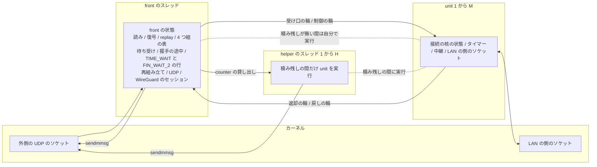
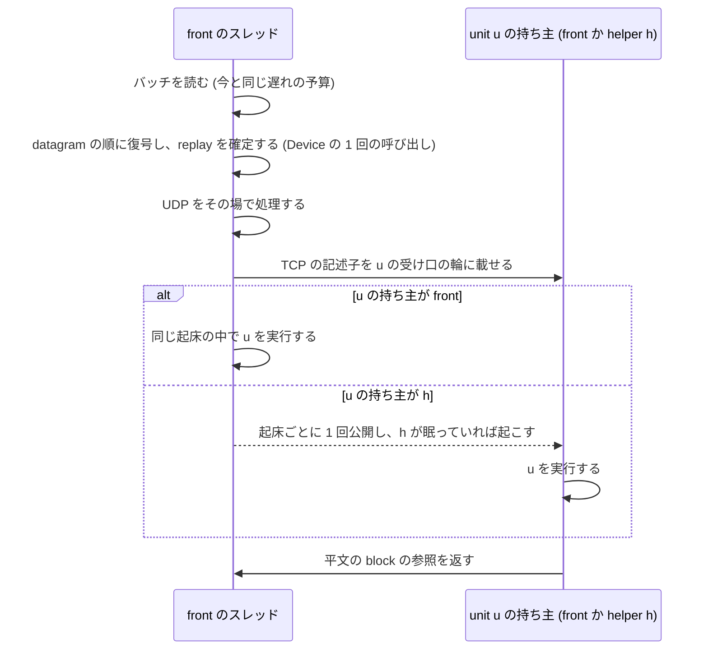

# 所有と同期の設計 (N2)

この文書は、推奨の構成 U で、状態ごとの持ち主、unit を実行する権利とその受け渡し、データの流れ、接続を unit に置く手順、同期の点とその頻度を定めます。
未採用の提案です([提案の索引](README.md))。
構成を選んだ理由は[構成の比較](architecture.md#s-と-u-の比べ)にあります。

## 所有の全体図

front の状態は front のスレッドだけが実行し、unit は持ち主の executor (front のスレッドか helper のスレッド) が実行します。
積み残しが無い間は、全 unit の持ち主は front のスレッドです。
利用できる CPU が 1 つの時は unit も helper も無く、今の Inline の経路そのものです。

## 状態の置き場の原則

- 状態と実行を分けます。
  unit は状態の区画で、どのスレッドが実行しても中身は同じです。
  executor はスレッドで、ある時点で 1 つの unit を実行するのは、その unit の持ち主の executor だけです
- 各 unit の核は、今と同じく自分の状態だけを `&mut` で持つ値で、核の中に `unsafe`、錠、atomic を入れません(設計判断)
- front の状態は、外側のソケット、WireGuard のセッション (sanstun の `Tunnel`)、4 つ組の表、待ち受け、accept の待ち行列、握手の途中、TIME_WAIT と FIN_WAIT_2 の行、再組み立て、UDP です。
  front のスレッドだけが実行します
- 接続は作成の時に unit に置かれ、閉じるまで動きません。
  unit が executor の間を動いても、接続は unit の中に留まります
- 4 つ組の表は、TCP の接続を (unit、枠、世代) に写します。
  記述子は枠と世代を運ぶので、unit は表を引きません
- unit の数 M と helper の数 H は、利用できる CPU の数 n_cpu から決めます([CPU の数ごとの動かし方](performance.md#cpu-の数ごとの動かし方))

## 積み残しの定義

積み残しは、この提案で 1 つの意味だけに使います。

- 入る:front のスレッドの起床が遅れの予算 (50 µs) を使い切り、その後にも外側のソケットにデータが残ることが、続けて 8 回起きた時に入ります
- 出る:遅れの予算を使い切る起床が 100 ms の間無い時に出ます
- 値:8 回と 100 ms は仮の値で、試作で決めます

入るまでの 8 回は、1 回の小さな山で helper を起こさないためです。
出るまでの 100 ms は、unit を executor の間で行き来させないためです。

## 実行の権利と受け渡し

### 持ち主の executor

各 unit は、持ち主の executor を表す 1 つの語 (atomic) を持ちます。
持ち主だけがその unit を実行し、受け口の輪の読み手になります。
持ち主が変わるのは、次の 2 つの受け渡しの時だけです。
このため、unit を実行する権利の取り合いは起きず、起床ごとや packet ごとの CAS もありません(設計判断)。

起床ごとに front のスレッドが権利を取る形も検討しました。
その形では、LAN の側の準備の知らせが届く executor と、受信の packet を処理する executor が起床ごとに入れ替わり、unit の cache が起床ごとに core の間を移るので採りません。

### front から helper への受け渡し

積み残しの間、front のスレッドは、直近の受信の packet が最も多い unit から順に、起床ごとに 1 つずつ helper に渡します。

1. front は自分が持ち主の unit u を選びます。
   front は 1 つのスレッドなので、この時 u を実行していません
2. front は u の LAN の側のソケットを、自分の poller から helper h の poller に登録し直します
3. front は u の次のタイマーの期限を添えた受け取りの知らせを h の受け渡しの輪に載せ、u の持ち主の語を h にして (release)、h が眠っていれば起こします
4. h は知らせを受けて (acquire)、u の受け口の輪と制御の輪を読み、タイマーを自分の輪に入れ、u を実行します

手順の 3 の後に front が u に載せる packet は、h が読みます。
受け口の輪の読み手は手順の 3 の release と 4 の acquire で替わるので、輪は SPSC のままです。

### helper から front への戻し

積み残しを出た後、front は起床ごとに 1 つの unit に戻しの求めの印を立てます。

1. h は、u の 1 回の実行を終えた点で印を見ます
2. h は u の LAN の側のソケットを front の poller に登録し直し、u の次の期限を添えた戻しの知らせを front の受け渡しの輪に載せ、u の持ち主の語を front にして (release)、front が眠っていれば起こします
3. front は知らせを受けた後、u を自分の起床の中で実行します

### 持ち主が止まった時

helper が u を実行中に CPU を取られると、u の仕事はその間待ちます。
front は u の受け口の輪に載せ続け、u の平文の block の上限に達したら u の TCP の segment だけを捨てます([unit ごとの block の上限](memory.md#unit-ごとの-block-の上限))。
front、UDP、ほかの unit は止まりません。
front は止まった持ち主から u を取り上げません。
u は実行の途中かもしれず、状態の一貫を保てないためです(設計判断)。
止まった u には新しい接続を置きません([unit の選び方](#unit-の選び方))。

### 受け渡しの費用

受け渡しのたびに、u の作業の集まり (動いている接続の TCB、輪、直近の chunk) が別の core の cache に移ります。
数百 KiB を移すと、受け渡しごとに数十 µs 程度の cache の miss になると見込みます(推定)。
受け渡しは 1 回の積み残しにつき unit ごとに行きと帰りの 2 回で、unit の数 M は helper の数と同じなので、helper は前に実行した unit を受け取ります。

### タイマー

- 各 unit は、1 回の実行の終わりに次の期限を自分の状態に書きます
- 各 executor は、自分が持ち主の unit の期限の最小でタイマーを張ります。
  unit は M 個 (8 以下) なので、最小を求める手間は flow の数によりません
- 積み残しが無い間は全 unit の持ち主が front なので、front のタイマーだけが動き、helper は起きません

## LAN の側の I/O

unit の LAN の側のソケットは、持ち主の executor の poller に登録します。
持ち主が変わる時は、上の手順でソケットを登録し直します。

- poller:executor ごとに 1 つです。
  Linux では epoll で、upstream の crate (たとえば mio) を変えずに使う形を第一の候補にします
- 中継:今の中継は、データプレーンのスレッドの tokio の current-thread の実行環境の local task (`Rc` を持つ) なので、別のスレッドで実行できません。
  U では、中継を unit が持つ状態機械に作り直し、ノンブロッキングのソケットと executor の poller で動かします。
  データプレーンのスレッドは tokio を使わず、制御プレーンは今の tokio のままです
- 費用:中継の作り直しは、今の `relay` の module の大部分の書き直しです。
  登録し直しは、unit の持つソケットの数だけ system call を呼ぶので、受け渡し 1 回で数百 µs になりえます(推定)
- 利用できる CPU が 1 つの時:今の tokio の中継と Inline の経路をそのまま使います。
  このため、P0 から P3 の間は中継の実装が 2 つになります。
  1 つにまとめるかは、P3 の後に決めます
- Windows と macOS:今の Inline の経路のままです。
  U を Windows と macOS に広げるには、IOCP と kqueue の poller と、そこでの登録し直しの手順の設計が要ります

## unit の選び方

接続を置く unit は、受動の open では握手の最後の ACK を受けた時に、能動の open では dial の時に、front が選びます。

- 重み:front は、受け口の輪に載せた packet の数を unit ごとに数え、100 ms ごとに半分にします。
  front はすべての受信の packet を振り分けるので、数えに同期は要りません。
  送る向きの大きな flow も、受ける ACK の数で重く見えます
- 選ぶ unit:重みの最も小さい unit を選びます。
  同じなら生きている接続の少ない unit、それも同じなら番号の小さい unit です
- 外す unit:空きの枠が無い unit、平文の block の上限に達した unit、受け口の輪が空でないのに読み手の index が 10 ms 進んでいない unit を外します。
  front は読み手の index を relaxed で読むだけです
- すべて外れた時:今の accept の待ち行列が満ちた時と同じく、最後の ACK を捨てて握手の途中の行を残します。
  今の核では起きない条件なので、知った上での違いの一覧に入れます([今との違い](#今との違い))

作成の時の byte の数で選ばない理由は、同時に張る stream が作成の時にはどれも 0 byte で、区別できないためです。
同時に張った 4 本は、重みが同じなので接続の数で別々の unit に分かれます。

## 接続を unit に置く手順

### 受動の open

1. front は、握手の途中の行に当たる最後の ACK (または cookie の ACK) を受け、今と同じく accept の待ち行列の空きを確かめます
2. front は unit u と、u の空きの枠 j を選びます。
   枠は front が unit ごとに数えて割り当てます
3. front は、交渉した値の組 (MSS、窓の scale、SACK、timestamp、両方の ISN、timestamp の値、相手の窓)、最後の ACK の記述子、待ち受けの識別子を、作成の知らせとして u の制御の輪に載せます。
   最後の ACK の平文の block は、u の block の上限に数えます
4. front は、4 つ組の表の項を (u、j、世代) に替え、握手の途中の行を消し、accept の待ち行列に (u、j、世代) を入れます
5. u の持ち主は作成の知らせを受け、交渉した値の組から接続を確立し、最後の ACK が運んだデータと FIN を今と同じく処理します

### 能動の open

1. dial の求めは front に届きます
2. front は u と空きの枠 j を選び、一時ポートを選び、4 つ組の表で衝突を確かめ、表の項を入れます
3. front は dial の知らせを u の制御の輪に載せます
4. u の持ち主は枠 j に SYN-SENT の接続を作り、SYN を送ります

### 置く時の競合

置く点は、front が 4 つ組の表の項を替える 1 回の操作です。

| 競合 | 扱い |
|---|---|
| SYN の再送 | 置いた後なら u の確立した接続に届き、今の核と同じく確立した接続の SYN として扱います |
| 最後の ACK の再送 | 置いた後なら u に届き、重複の ACK として扱います |
| 最後の ACK が運ぶデータ | 作成の知らせが記述子を運び、確立の直後に処理します |
| 最後の ACK の直後のデータ | 受け口の輪で u に届きます。u は制御の輪を先に読み、知らない枠の記述子を見たら制御の輪を読み直します |
| 置く前の RST | front が握手の途中の行で今と同じく処理します |
| 置いた後の RST | u の接続が今と同じく処理します |

## front と unit の間の知らせ

捨ててよいデータの記述子と、捨ててはいけない知らせを、別の輪で運びます。
捨ててはいけない輪は、枠ごとの知らせの数の上界から容量を決めるので、満ちません。

### front から unit への知らせ (制御の輪)

| 知らせ | 1 つの枠の一生で出る数 |
|---|---|
| 作成か dial | 1 |
| accept の後の中継の開始 | 1 |
| 待ち受けの Close による accept の前の接続の終わり | 1 |
| 枠の中の TIME_WAIT の終わりの求め (使い直しの時) | 1 |

1 つの枠の知らせは 4 つまでで、unit ごとの知らせ (停止、受け渡しの知らせ) は 2 つまでです。
容量は 4 × N_c,u + 2 にします (N_c,u は unit u の枠の数)。

### unit から front への知らせ (返却の輪)

| 知らせ | 1 つの枠の一生で出る数 |
|---|---|
| 4 つ組の表から外す (CLOSED になった時か、TIME_WAIT と FIN_WAIT_2 の行に移る時)。行に移る時は行の中身を運びます | 1 |
| 枠の解放 (アプリケーションが閉じた後) | 1 |

今の核は、CLOSED になった時 (`enter_closed`) に 4 つ組の表と accept の待ち行列から外し、アプリケーションが閉じた時に枠を返します (`crates/wgft-wgstack/src/tcp/ctx.rs`)。
U でも同じ時機に知らせを出すので、RST を受けた後の同じ 4 つ組の新しい SYN は、今と同じく待ち受けに届きます。
表から外すのは `in_index` で 1 回に限られ、枠は front が解放の知らせを処理するまで割り当て直さないので、1 つの枠の知らせは 2 つまでです。
容量は 2 × N_c,u にします。

### unit から front へ戻す packet (戻しの輪)

unit に届いた SYN のうち、unit が処理せず front に渡すものがあります。

- 枠の中の TIME_WAIT への SYN:unit は RFC 6191 の番号と timestamp の条件を確かめ、満たせば SYN と TIME_WAIT の値 (相手の timestamp、RCV.NXT、SND.NXT) を front に渡します。
  front は待ち受けと握手の途中の空きを確かめ、受け入れるなら枠の中の TIME_WAIT の終わりを unit に求め、表から外す知らせを受けた後に握手の途中の行を作ります。
  受け入れないなら、渡された値から TIME_WAIT の ACK を作って送ります。
  今の核の使い直しと同じ出力です
- 表から外した後に届いた SYN:front が表を替える前に unit に載った SYN は、front に渡します

戻しの輪は容量を固定 (仮の値は 64) にし、満ちたら SYN を捨てて数えます。
満ちるのは front が詰まり SYN が多い時だけで、相手は SYN を送り直します。
今の核では起きない捨て方なので、知った上での違いの一覧に入れます。

## 受ける向きのデータの流れ

## 送る向きのデータの流れ

- u の持ち主が front:front は u の segment を、今の `Device::handle_packet` の 1 回の呼び出しで暗号化し、その起床で実行した全 unit の datagram と UDP を 1 つの送りのバッチにまとめて送ります。
  Inline と同じ形です
- u の持ち主が helper:helper は u の segment を front から借りた counter で暗号化し、自分で外側のソケットへ送ります([WireGuard のセッションと counter](#wireguard-のセッションと-counter))

## WireGuard のセッションと counter

front だけが sanstun の `Tunnel` を `&mut` で持ち、錠を置きません。
helper の暗号化には、front が貸す counter を使います。
貸し出しは積み残しの間だけ働き、積み残しが無い間は front が今の形で暗号化します。

### 貸し出しの手順

1. helper は、暗号化する segment を持つ時だけ、要る数を求めの語 (helper ごとの atomic) に書きます
2. front は起床ごとに求めの語を読み、`begin_encapsulate` を要る数だけ呼び、`PendingEncapsulate` (鍵の写し、受け手の index、counter) と endpoint を helper の貸し出しの輪に載せます
3. helper は借りた `PendingEncapsulate::encrypt` で暗号化し、送ります

在庫は持たず、求めた数だけを貸します。
helper の送りは、求めてから front の次の起床までの間 (積み残しの間は 50 µs 程度まで) 待ちます(推定)。
積み残しの間 front は起きているので、求めのための起床は通常起きません。
積み残しを出た後に helper に unit が残っている間だけ、helper が眠っている front を起こすことがあります。

### sanstun のタイマーへの影響

`begin_encapsulate` は、最後に送った時刻と最後にデータを送った時刻を記録し、wgft の passive keepalive の期限も解きます。
このため、貸して使わなかった counter は、送っていない送りをタイマーに記録します。

- 使わない貸し出し:暗号化し直し、helper から unit が戻る時の残り、engine の停止の時だけです。
  求めた数だけを貸すので、通常は残りません
- 起きうること:相手から受けたデータに返すべき passive keepalive が出ないことと、自分のデータに返事が無い時の handshake の開始が早く始まることです。
  データが失われることはありません
- 起きにくい理由:貸し出しが働くのは積み残しの間で、トンネルは両方の向きにデータを運んでいます(推定)
- 試験:積み残しの後に静かになったトンネルで、keepalive と handshake の開始が今と同じ時機に出ることを確かめます([正しさの試験](verification.md#正しさの試験))

### device の層の確かめ

今の `Device::handle_packet` が行う確かめを、貸し出しの道でも行います。

| 確かめ | 貸し出しの道での扱い |
|---|---|
| 内側の IPv4 の header | helper が確かめます |
| MTU (`TooBig`) | helper が設定の写しで確かめます |
| 経路 (allowed IPs) | helper が経路の表の読み取り専用の写しで確かめます。設定の変更は制御の輪で写しを替えます |
| endpoint | 貸し出しに添えた endpoint を使います。endpoint が無ければ front は貸しません |
| セッションの有無と待ちの packet | セッションが無ければ front は貸さず、helper は核から引きません |
| ピアごとの送った数 | helper ごとに数え、読む時に合わせます |

### replay の窓への距離

貸し出しにより、相手が受ける counter の順は executor の間で乱れます。
相手の窓は wireguard-go と Linux で 8,128 です([WireGuard の仕様との違い](../../v2/wireguard-device.md#wireguard-の仕様との違い))。

- 確かめ:helper は送る直前に、front が貸すたびに公開する (受け手の index、最新の counter) と、送る datagram の値を比べます。
  同じ受け手の index で差が 4,064 を超えていれば、送信の枠に残る平文を新しい counter で暗号化し直します
- 鍵の交換の後:受け手の index が違う古いセッションの counter は、古いセッションの窓の中の値なので、そのまま送ります。
  相手は前のセッションの鍵でも受け付けます
- 閉じられない隙:確かめから `sendmmsg` までの間に helper が CPU を取られると、datagram は窓の外で相手に捨てられることがあります。
  TCP は損失として回復します。
  暗号化し直しの回数と相手の再送の数で頻度を見ます([受け入れの条件](verification.md#受け入れの条件))

## 同期の点と頻度

頻度は、積み残しの間の 1 Mpps (MTU 1,420 で約 11 Gbit/s) の推定です。
積み残しが無い間は、front のスレッドが全部を実行するので、下の点はどれもほかのスレッドと競いません。

| 同期の点 | 方法 | 頻度 | 競合 |
|---|---|---|---|
| 受け口の輪 (front から unit) | SPSC。index の公開は front の起床と unit の組ごとに 1 回 | 起床ごと | 無し |
| 制御の輪 (front から unit) | SPSC。容量 4 × N_c,u + 2 | 接続ごと | 無し。満ちません |
| 返却の輪 (unit から front) | SPSC。容量 2 × N_c,u | 接続ごと | 無し。満ちません |
| 戻しの輪 (unit から front) | SPSC。容量 64。満ちたら SYN を捨てます | 戻す SYN ごと | 無し |
| block の返却 (unit から front) | SPSC。容量は block の数以上 | block と unit の組ごと | 無し |
| 受け渡しの輪 (executor ごと) | SPSC。容量 M | 受け渡しごと (積み残しの出入り) | 無し |
| 持ち主の語 (unit ごと) | 受け渡しの時に release で書き、acquire で読みます | 受け渡しごと | 無し |
| 求めの語 (helper から front) | helper ごとの atomic | helper の送りのバッチごと | 無し |
| 貸し出しの輪 (front から helper) | SPSC | front の起床ごと | 無し |
| 最新の counter | front が書く (受け手の index、counter) | 貸すたび | 無し |
| 起こす知らせ | 相手の眠りの印を見て、眠っている時だけ起こします | 公開ごとに見ます | 無し |
| 読み手の index (止まった unit の判定) | front が relaxed で読みます | 接続を置く時 | 無し |
| 予算の credit | 全体の空きの数への CAS | 1 MiB の credit ごと | 低い |
| 回収の求め | unit ごとの atomic の印 | 全体の空きが尽きた時 | 無し |
| 外側のソケットの書ける知らせ | 各 executor が自分の複製した記述子で待ちます | 書けない時だけ | 待つ executor だけが起きます |
| 毒の印 (panic) | engine で 1 つの atomic の bool。立てた executor が全 executor を起こします | panic の時 | 無し |

錠は 1 つもありません。

## TCP の接続の持ち主と状態の移り

| 状態 | 置き場 | 持ち主 |
|---|---|---|
| LISTEN | 待ち受けの表 | front |
| SYN-RCVD | 握手の途中の行か状態の無い cookie | front |
| SYN-SENT から LAST-ACK | 接続の枠 | 作成の時の unit |
| accept の前の ESTABLISHED | 接続の枠と、front の accept の待ち行列の項 | unit (待ち行列の項は front) |
| 枠の中の FIN_WAIT_2 と TIME_WAIT | 接続の枠 | 作成の時の unit |
| FIN_WAIT_2 と TIME_WAIT の行 | 行の表 | front |

状態機械の移りは今の核と同じです。
接続の状態の持ち主が変わるのは、握手の最後と、行に移る時の 2 点だけで、どちらも接続がデータを持たない点です。

## 待ち受け、accept、dial、一時ポート

- 待ち受けの開閉:front の核が今と同じく行います。
  待ち受けの Close は、accept の前の接続の終わりを制御の輪で unit に求めます
- accept:accept の待ち行列は front にあり、項は (unit、枠、世代) です。
  agent の中継の accept は front で行い、中継の開始を制御の輪で unit に求めます。
  accept の前に閉じた接続は、表から外す知らせで front が待ち行列から外します
- dial:front が一時ポートを選び、4 つ組の表で衝突を確かめます。
  表は動いている接続、握手の途中、SYN-SENT、行のすべてを持つので、確かめは 1 つのスレッドの論理のままです

## UDP の持ち主

- UDP の endpoint とセッションは front が持ちます。
  外側のソケットの準備で起きる front が中継まで処理するので、UDP は Inline と同じくスレッドを移りません
- 大きな量の UDP (QUIC の download など) は、front の 1 つの CPU に収まる分までです。
  基本の設計の制限として受け入れます

## IPv4 の再組み立てと ICMP

- 再組み立ての表は front が持ち、今の 1 秒ごとの掃除をそのまま使います。
  掃除の対象は 128 個までの項目で、利用できる CPU が 1 つの時の出力を今と同じに保つためです
- 組み立てた datagram は、再組み立ての置き場から平文の block に写し、受け口の輪で unit に渡します
- 受けた ICMP の誤りは、front が引用の 4 つ組で unit を引き、受け口の輪で渡します。
  PMTU を下げる処理は unit の接続で行います
- echo、ping の endpoint、送る ICMP の誤りは front が持ちます
- challenge ACK は接続の unit が送ります。
  速さの bucket は全体の上限を unit の数で分けた値を各 unit が持ち、全体の上限を超えません(設計判断)

## タイマーと再送

- 接続のタイマーは unit の核のタイマーの輪にあり、unit の持ち主の executor が期限を見ます([タイマー](#タイマー))
- 握手の途中、行、再組み立て、WireGuard のタイマーは front が持ちます
- どの executor も次の期限を O(1) か unit の数の手間で求め、flow の数に比例する走査を持ちません

## flow をまたぐ送り出しの順

- unit の中:今の核の出力の規則 (4 つの組の byte の deficit round robin、接続の間は 1 segment ずつ) を保ちます
- front:UDP を先にする今の規則を保ちます。
  積み残しが無い間は、全 unit の送りも同じバッチの中で UDP の後に並びます
- 積み残しの間:helper は自分の CPU で独立に送ります。
  外側のソケットが満ちた時に、front の UDP が helper の送りより先にソケットの空きを得る仕組みはありません。
  知った上での違いとして、最大の送る負荷の UDP の遅れで確かめます

## スレッドの間の packet の順

flow の中の順は、次の 4 つで保ちます。

1. 受ける向き:front は datagram を読んだ順に復号し、同じ順に振り分けます
2. 受ける向き:1 つの接続の packet は、すべて同じ unit の 1 つの受け口の輪に入り、輪は FIFO です。
   持ち主が替わっても輪は同じで、受け渡しの release と acquire が順をつなぎます
3. 置く点:作成の知らせは、その接続のどの記述子より先に公開されます
4. 送る向き:1 つの接続の segment は unit の持ち主だけが作り、作った順に暗号化して送ります

## 1 つの持ち主から多くの持ち主へ移しても TCP の状態機械が保たれる理由

確立した後の TCP の接続の状態を読み書きするのは、その unit の持ち主の 1 つのスレッドだけです。
持ち主が替わる時は、前の持ち主がその unit の実行を終えた点で替わり、受け渡しの release と acquire が状態の見え方をつなぎます。
このため、1 本の接続から見た入力の列 (packet、タイマー、操作) は、利用できる CPU が 1 つの時と同じ種類と同じ順の列で、処理するスレッドが途中で替わることがあるだけです。
握手の途中から確立への移りは、dial の設計が決めた、交渉した値の組から始める 1 つの入口を通ります([受動と能動の open に共通の TCP の状態の模型](api.md#受動と能動の-open-に共通の-tcp-の状態の模型))。

接続の状態機械に見える変更は、次の 2 つです。

- 予算:段を大きくできるかどうかは unit の credit と全体の予算で決まります。
  尽きた時の扱い (今の段に留まる) は今と同じです
- 速さの bucket:challenge ACK の bucket が unit ごとになります

## 今との違い

利用できる CPU が 2 つ以上の時に、今の核と出力が違いうる点は次のとおりです。

| 違い | 起きる時 |
|---|---|
| challenge ACK の速さの上限を unit ごとに分けます | 1 つの unit に偏った攻撃の時、今より早く尽きます |
| 戻しの輪が満ちたら SYN を捨てます | front が詰まり、戻す SYN が 64 を超えた時 |
| すべての unit が外れたら最後の ACK を捨てます | すべての unit が止まったか、枠か block の上限に達した時 |
| 外側のソケットの空きを UDP が先に得ません | 積み残しの間に外側のソケットが満ちた時 |

## ワーカーの停止と再起動

- 停止:トンネルの世代を作り直す時は engine 全体を止めます。
  front が各 unit に制御の輪で停止を知らせ、各 unit の持ち主が接続を閉じ、予算を返してから終わります
- panic:どの executor の panic も engine の毒の印を立て、立てた executor が全 executor を起こします。
  各 executor は起きた時に印を見て止まり、世代を終えます。
  1 つの unit だけを作り直すことはしません(設計判断)
- 世代の受け渡し:全体の予算と置き場は、今の `Budget` と同じく次の世代に渡します

## device とネットワークの I/O の持ち主

| I/O | 持ち主 |
|---|---|
| 外側のソケットの読み | front |
| 外側のソケットへの送り | front と、積み残しの間の helper。各 executor は複製した記述子で書ける知らせを待ちます |
| device の層の送る datagram (ハンドシェイク、cookie、keepalive) | front。データより先に送る今の規則を保ちます |
| LAN の側の TCP のソケット | unit。持ち主の executor の poller に登録します |
| LAN の側の UDP のソケット | front |
| 名前の解決のスレッド | 今と同じく別のスレッド。結果は front に届けます |
| 制御プレーンからの命令 | front が受けます |

## link の queue の数と将来の server

link が flow の hash で分けた複数の queue を持つ形と、多くのピアを持つ server を外側のアドレスでピアごとに分ける形は、将来の拡張で、設計していません。
最初の試作は queue が 1 つの形だけを作ります。

## 今の Shared の欄の新しい持ち主

今の核の `Shared` (`crates/wgft-wgstack/src/stack/shared.rs`) と接続の枠の欄を、すべて新しい持ち主に対応させます。

| 欄 | 今の意味 | 新しい持ち主と形 |
|---|---|---|
| `config` | アドレス、MTU、上限、輻輳制御 | front と各 unit の読み取り専用の写し。unit の番号と M を加えます |
| `addr` | 受け付けるアドレス | 各写し |
| `now` | 最後に見た時刻 | front と unit ごと。プロセスで 1 つの起点の時計から、実行する executor が読みます |
| `isn_key`、`ts_key`、`cookie_key` | 鍵付きの hash の鍵 | 読み取り専用の写し |
| `cookie_sent` | 最後に cookie を送った時刻 | front |
| `ip_id` | 送る packet ごとの IP ID | front と unit ごと。M + 1 おきの重ならない値を使います。利用できる CPU が 1 つなら今と同じです |
| `rng` | 乱数 | front と unit ごと。種は全体の種と番号から導き、front は今と同じ種です |
| `conn_free` | 空きの枠の list | front が unit ごとに持ちます。解放の知らせで戻ります |
| `qlinks`、`queued` | accept の待ち行列 | front。項は (unit、枠、世代) です |
| `conn_idx` | 4 つ組から枠への表 | front。項は (unit、枠、世代) です |
| `syn` | 握手の途中の表 | front |
| `tw` | TIME_WAIT と FIN_WAIT_2 の行の表 | front |
| `listeners` | ポートごとの待ち受けの行 | front |
| `out` | 出力の組と制御の輪 | front と unit ごと |
| `events` | 知らせの list | front と unit ごと。ポートの知らせは front だけが持ちます |
| `wheel`、`fired` | タイマーの輪 | front と unit ごと。節の数は unit の枠の数で決まります |
| `chunks` | 16 KiB の chunk の置き場 | front と unit ごと([chunk と大きいバッファの置き場](memory.md#chunk-と大きいバッファの置き場)) |
| `frag`、`frag_next_sweep` | 再組み立て | front。今と同じ 1 秒ごとの掃除です |
| `udp` | UDP の endpoint、予算、送信の FIFO | front |
| `pings` | ping の endpoint | front |
| `icmp_sec`、`icmp_count` | ICMP の誤りの速さ | front |
| `budget` | boost の枠の予算 | 全体の予算と unit ごとの credit。保有者の list と回収は unit ごと |
| `ch_sec`、`ch_count` | challenge ACK の速さ | unit ごと。全体の上限を unit の数で分けます |
| `stats` | 数え | front と unit ごと。読む時に合わせます |
| `gates` | ログの 1 分の門 | unit ごとに材料を作り、front が engine で 1 分に 1 回に絞ります |
| `ConnSlots` の `with_arrays` | 配列を持つ枠の数 | unit ごと |
| `hook` | boost の hook と LAN のソケットの表 | unit ごと。表の行の数は unit の枠の数です |

[提案の索引](README.md)
