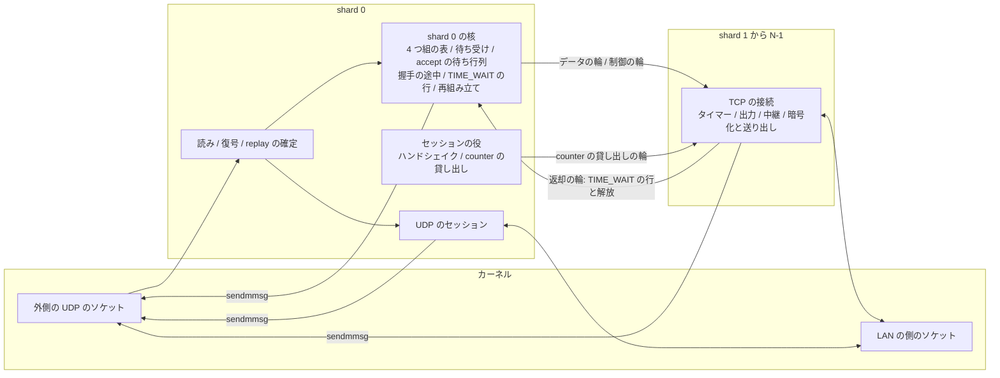
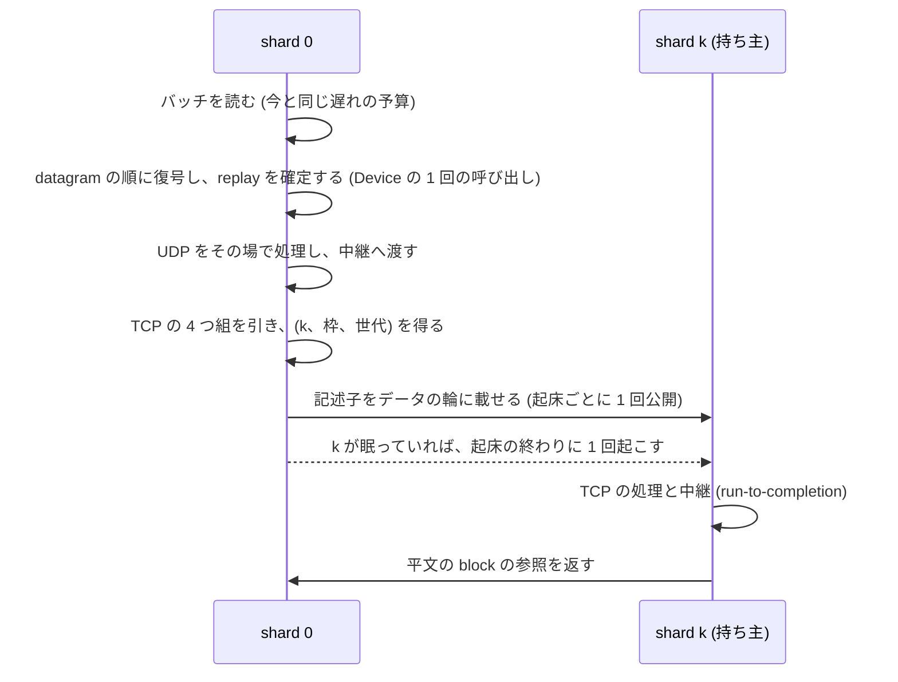
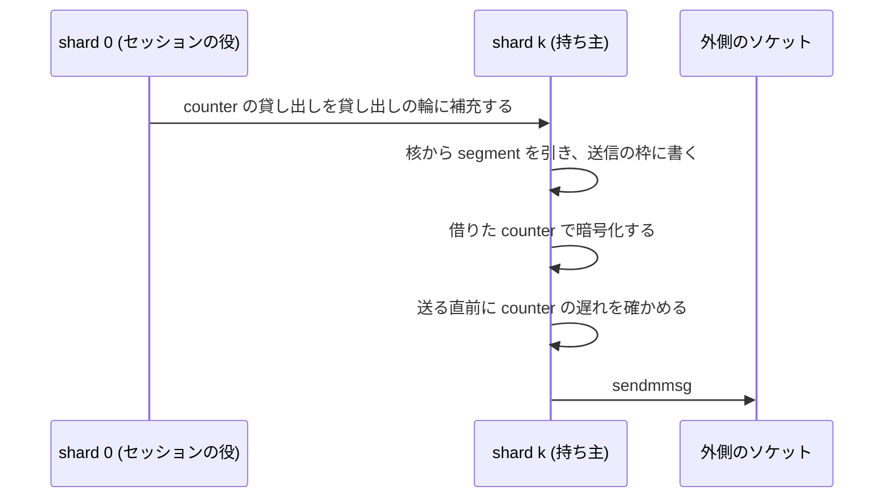

# 所有と同期の設計 (N2)

この文書は、推奨の構成 S で、状態ごとの持ち主、受ける向きと送る向きのデータの流れ、接続を持ち主に渡す手順、同期の点とその頻度を定めます。
未採用の提案です([提案の索引](README.md))。
構成を選んだ理由は[構成の比較](architecture.md#推奨の構成-s)にあります。

## 所有の全体図

shard 0 は、外側のソケットの読み、復号、replay の確定、振り分け、接続を作る表、UDP、WireGuard のセッションを持ちます。
shard 1 から N-1 (持ち主の shard) は、作成の時に置かれた TCP の接続を、閉じるまで持ちます。
N = 1 の時は shard 0 だけがあり、今の Inline の経路そのものです。

## 状態の置き場の原則

- 各 shard の核は、今と同じく自分の状態だけを `&mut` で持つ値で、ほかの shard と共有するメモリを持ちません。
  核の中に `unsafe`、錠、atomic を入れない今の規則を保ちます(設計判断)
- 接続は作成の時に持ち主の shard を決め、閉じるまで動かしません。
  動いている接続を別の shard へ移すことは、基本の設計に含めません([代わりの形として残す昇格](architecture.md#代わりの形として残す昇格))
- shard 0 の 4 つ組の表は、TCP の接続を (持ち主の shard、枠、世代) に写します。
  shard 0 は今の入口の検索だけで振り分け先を知り、記述子に枠と世代を書くので、持ち主は表を引きません
- 接続を作る表 (待ち受け、accept の待ち行列、握手の途中、TIME_WAIT の行、再組み立て) と UDP は shard 0 だけが持ちます
- 接続の枠は持ち主の shard に分けます。
  shard k の枠の数を N_c,k とし、Σ_k N_c,k = N_c です
- WireGuard のセッションの状態 (sanstun の `Tunnel`) は shard 0 だけが持ち、錠を置きません

## 持ち主の選び方

### 選ぶ時機

持ち主は、受動の open では握手の最後の ACK を受けた時に、能動の open では dial の時に決めます。
accept の時ではなく最後の ACK の時にする理由は次のとおりです(設計判断)。

- 最後の ACK の時は、接続はまだデータを持たず、タイマーも中継の task も LAN の側のソケットもありません。
  渡すのは交渉した値と最後の ACK の packet だけで、動いている接続の移しになりません
- accept の時にすると、accept までに届いたデータ、送った ACK、受信の輪、段の予算を持った接続を移すことになり、昇格 ([代わりの形として残す昇格](architecture.md#代わりの形として残す昇格)) と同じ手順と危険が要ります

### 選ぶ規則

- N が 3 以上:TCP の接続は shard 1 から N-1 に置き、shard 0 には置きません。
  shard 0 は読み、復号、UDP、握手を持つので、TCP の仕事を置くと UDP が TCP の後ろで待つためです
- N = 2:shard 0 と shard 1 の両方に置きます。
  shard 0 を除くと、すべての TCP の packet がスレッドを移る 2 段の pipeline になり、軽い負荷の費用が増えるためです(推定)。
  2 CPU で N = 2 と N = 1 のどちらを使うかは測定で決めます([CPU の数ごとの動かし方](performance.md#cpu-の数ごとの動かし方))
- 選び方:候補の shard のうち、生きている接続の数が最も少ない shard を選び、同じ数なら順に回します。
  数は shard 0 が自分で作った数と、返却の知らせで減らした数なので、正確で同期が要りません
- 空き:枠の空きが無い shard は選びません。
  どの shard にも空きが無ければ、今と同じく最後の ACK を捨てて握手の途中の行を残します

負荷の大きさで選ばない理由は、作成の時の負荷が先の負荷を表さないためです。
たとえば iperf3 は 4 本の stream を数 ms の内に張るので、作成の時の byte の数はどの shard でも 0 です(推定)。
接続の数で選ぶと、同時に張った 4 本は 3 つの持ち主に 2、1、1 本に分かれます。
長く生きる静かな接続も 1 本と数えるので、偏りは残ります([flow の公平とワーカーの公平](performance.md#flow-の公平とワーカーの公平))。

## 接続を持ち主に渡す手順

### 受動の open

1. shard 0 は、握手の途中の行に当たる最後の ACK (または cookie の ACK) を受け、今と同じく accept の待ち行列の空きを確かめます
2. shard 0 は持ち主 k と、k の空きの枠 j を選びます
3. shard 0 は、交渉した値の組 (MSS、窓の scale、SACK、timestamp、両方の ISN、timestamp の値、相手の窓)、最後の ACK の packet の記述子、待ち受けの識別子を、作成の知らせとして k の制御の輪に載せます
4. shard 0 は、4 つ組の表の項を (k、j、世代) に替え、握手の途中の行を消し、accept の待ち行列に (k、j、世代) を入れます
5. k は作成の知らせを受け、交渉した値の組から接続を確立し、最後の ACK が運んだデータと FIN を今と同じく処理します

SYN-ACK で広告した窓は、設定の最初の受信の予約から決まる値で、k が確立する接続の最初の窓と同じです。

### 能動の open

1. dial の求めは shard 0 に届きます
2. shard 0 は持ち主 k と空きの枠 j を選び、一時ポートを選び、4 つ組の表で衝突を確かめ、表の項を (k、j、世代) で入れます
3. shard 0 は dial の知らせを k の制御の輪に載せます
4. k は枠 j に SYN-SENT の接続を作り、SYN を送ります

SYN-ACK は SYN の後にしか届かず、表の項は SYN の前に入っているので、SYN-ACK は必ず k に振り分けられます。

### 渡す時の競合

渡す点は、shard 0 が 4 つ組の表の項を替える 1 回の操作です。
その前に届いた packet は shard 0 が握手の途中の行で処理し、その後に届いた packet は k に振り分けます。

| 競合 | 扱い |
|---|---|
| SYN の再送 | 渡した後なら k の確立した接続に届き、今の核と同じく確立した接続の SYN として扱います |
| 最後の ACK の再送 | 渡した後なら k に届き、重複の ACK として扱います |
| 最後の ACK が運ぶデータ | 作成の知らせが packet の記述子を運び、k が確立の直後に処理します |
| 最後の ACK の直後のデータ | データの輪で k に届きます。k は制御の輪を先に読むので、作成より前に処理しません |
| 渡す前の RST | shard 0 が握手の途中の行で今と同じく処理します |
| 渡した後の RST | k の接続が今と同じく処理します |

k は、データの輪に知らない (枠、世代) の記述子を見つけたら、制御の輪を読み直します。
shard 0 は作成の知らせを先に公開するので、データの記述子が見えた時には作成の知らせも見えます。

## 持ち主から shard 0 へ返すもの

- TIME_WAIT の行:接続が行に移る条件 ([行に移る条件](../../userspace/wgstack.md#行に移る条件)) を満たしたら、k は行の中身を返却の輪で shard 0 に送り、枠を空きに戻します。
  shard 0 は TIME_WAIT の行を入れ、4 つ組の表の項を行に替えます
- 解放:TIME_WAIT の行を持たずに閉じた接続 (RST、`abort`、dial の取り消し) は、k が解放の知らせを送り、shard 0 が表の項を外します
- 返却の輪は、枠ごとに 1 つの知らせだけを運び、容量を k の枠の数にするので、満ちることも捨てることもありません(設計判断)
- 返した後の packet:返却の知らせの後で shard 0 が項を替えるまでに k に届いた packet は、k が世代の違いで見分けて捨て、数えます。
  捨てるのは閉じる途中の接続の再送 (FIN、ACK、RST) なので、相手の次の再送が shard 0 の TIME_WAIT の行に届きます

## 受ける向きのデータの流れ

- 復号は shard 0 が datagram の順にその場で行い、今の `Device::handle_datagram` の 1 回の呼び出しを使います。
  受信の側に分けた API とセッションの錠を置きません
- 平文は、平文の置き場の block に書きます。
  block は持ち主ごとに参照を数え、持ち主が処理を終えたら返却の輪で返します([持ち主ごとの block の上限](memory.md#持ち主ごとの-block-の上限))
- shard 0 は持ち主ごとに、自分の起床の終わりに 1 回だけ公開と起床を行います

## 送る向きのデータの流れ

- 持ち主は自分の接続の segment を作り、暗号化し、外側のソケットへ送ります
- UDP、制御の packet、shard 0 の接続 (N ≤ 2) は shard 0 が今と同じく送ります

## WireGuard のセッションと counter

送る counter と鍵は、shard 0 から持ち主への貸し出しで渡します(設計判断)。
セッションの錠を置く形と比べた結果は次のとおりです。

| 形 | 中身 | 頻度と競合 | 持ち手が止まった時 |
|---|---|---|---|
| 貸し出し (採ります) | shard 0 だけが `Tunnel` を `&mut` で持ち、`begin_encapsulate` で作った `PendingEncapsulate` (鍵の写し、受け手の index、counter) を持ち主ごとの SPSC の輪に補充します。持ち主は `PendingEncapsulate::encrypt` で暗号化します | 輪の補充は持ち主の在庫が下の線を下回った時。競合は無し | shard 0 が止まっても、持ち主は在庫を使い切るまで送れます。在庫 256 で 1 shard あたり 14 万 pps なら約 1.8 ms です(推定) |
| セッションの錠 | 送り手がバッチごとに錠を取り、中で `begin_encapsulate` を n 回呼び、暗号化は錠の外 | shard 0 の受信もバッチごとに同じ錠を取ります | 錠を持つ送り手が止まると、shard 0 の受信と UDP がその間止まります |

- sanstun は変えません。
  `begin_encapsulate` と `PendingEncapsulate::encrypt` は sanstun の公開の API で、device の層 (`wgft-wireguard`) に貸し出しの口を加えるだけです
- shard 0 の費用:送る packet ごとの `begin_encapsulate` (数十 ns、推定) と、貸し出しの書き込みです
- 宛先:貸し出しの補充に、その時の endpoint を添えます。
  endpoint が変わった後の補充から新しい宛先を使います
- セッションが無い時:shard 0 は補充しません。
  持ち主は在庫が無ければ核から引かず、セッションができた時に shard 0 が補充と同時に起こします
- 古い貸し出し:持ち主は、作られてから 1 秒を超えた貸し出しを捨てます。
  鍵の交換 (120 秒) と使えなくなる時刻 (180 秒) より十分に短くするためです
- 最後に送った時刻:sanstun は `begin_encapsulate` の時刻を送った時刻として記録するので、実際の送りより早い時刻が記録されます。
  その結果、keepalive が要らない時にも送られうるだけで、keepalive が欠けることはありません(推定)

### replay の窓への距離

貸し出しにより、相手が受ける counter の順は shard の間で乱れます。
相手の窓は wireguard-go と Linux で 8,128 です([WireGuard の仕様との違い](../../v2/wireguard-device.md#wireguard-の仕様との違い))。

- 乱れの上界:持ち主の在庫の和 (N-1) × 256 と、暗号化から送り出しまでの間に発行された数の和です。
  N = 8 で在庫の和は 1,792 です(計算)
- 送る直前の確かめ:持ち主は、shard 0 が貸し出しの補充ごとに公開する最新の counter (書き手 1 つの atomic) と、送る datagram の counter の差を見ます。
  差が窓の半分の 4,064 を超えていれば、送信の枠に残る平文を新しい貸し出しで暗号化し直します
- 閉じられない隙:確かめから `sendmmsg` までの間に持ち主が止まると、datagram は窓の外で相手に捨てられることがあります。
  TCP は損失として回復し、送り手はその数を数えません。
  頻度は CPU の取り合いの試験で相手の再送の数として見ます([受け入れの条件](verification.md#受け入れの条件))

## 同期の点と頻度

頻度は、1 Mpps (MTU 1,420 で約 11 Gbit/s) の推定です。

| 同期の点 | 方法 | 頻度 | 競合 |
|---|---|---|---|
| データの輪 (shard 0 から k) | SPSC。index の公開は shard 0 の起床ごとに 1 回 | 起床と持ち主の組ごと | 無し |
| 制御の輪 (shard 0 から k) | SPSC。容量は k の枠の数と定数。作成、dial、accept の後の中継の開始、停止を運びます | 接続ごと | 無し。満ちません |
| 返却の輪 (k から shard 0) | SPSC。容量は k の枠の数 | 接続ごと | 無し。満ちません |
| block の返却 (k から shard 0) | SPSC。容量は block の数以上 | block と持ち主の組ごと | 無し |
| 貸し出しの輪 (shard 0 から k) | SPSC。容量は在庫の上限 | 補充ごと (在庫の半分ごと) | 無し |
| 最新の counter | shard 0 が書く atomic。持ち主が送りのバッチごとに読みます | 書きは補充ごと | 無し |
| 送信の枠の返却 | 持ち主が自分の枠を自分で返します | 無し | 無し |
| 起こす知らせ | 相手の眠りの印を見て、眠っている時だけ起こします | 公開ごとに見ます | 無し |
| 予算の credit | 全体の空きの数への CAS | 1 MiB の credit ごと | 低い |
| 回収の求め | shard ごとの atomic の印 (重ねて立てても 1 つ) | 全体の空きが尽きた時 | 無し |
| 遅れに敏感な UDP の印 | shard 0 が書き、持ち主が送りのバッチごとに読みます | 書きは印が変わる時 | 無し |
| 外側のソケットの書ける知らせ | 各 shard が自分の複製した記述子で待ちます | 書けない時だけ | 待つ shard だけが起きます |
| 毒の印 (panic) | engine で 1 つの atomic の bool | 書きは panic の時 | 無し |

錠は 1 つもありません。
shard 0 から k への知らせは、捨ててよいデータの記述子 (データの輪) と、捨ててはいけない知らせ (制御の輪) で輪を分けます。

## TCP の接続の持ち主と状態の移り

| 状態 | 置き場 | 持ち主 |
|---|---|---|
| LISTEN | 待ち受けの表 | shard 0 |
| SYN-RCVD | 握手の途中の行か状態の無い cookie | shard 0 |
| SYN-SENT | 接続の枠 | 作成の時の持ち主 |
| ESTABLISHED から LAST-ACK | 接続の枠 | 作成の時の持ち主 |
| accept の前の ESTABLISHED | 接続の枠と、shard 0 の accept の待ち行列の項 | 持ち主 (待ち行列の項は shard 0) |
| TIME_WAIT (枠の中) | 接続の枠 | 作成の時の持ち主 |
| TIME_WAIT (行) | TIME_WAIT の表 | shard 0 |

状態機械の移りは今の核と同じです。
持ち主が変わるのは、握手の最後の時の 1 回と、TIME_WAIT の行への移りの 1 回だけで、どちらも接続がデータを持たない点です。

## 待ち受け、accept、dial、一時ポート

- 待ち受けの開閉:shard 0 の核が今と同じく行います
- accept:accept の待ち行列は shard 0 にあり、項は (持ち主、枠、世代) です。
  agent の中継の accept の loop は shard 0 で動き、accept した接続の中継の task を持ち主の shard で始めるよう、制御の輪で求めます。
  accept の前に閉じた接続は、解放の知らせで世代が変わるので、待ち行列から取り出した時に見分けて飛ばします
- dial:shard 0 が一時ポートを選び、4 つ組の表で衝突を確かめます。
  表は動いている接続、握手の途中、SYN-SENT、TIME_WAIT の行のすべてを持つので、確かめは 1 つのスレッドの論理のままです
- 一時ポートの尽き:shard 0 が誤りを返して数えます

## UDP の持ち主

- UDP の endpoint とセッションは shard 0 が持ちます。
  外側のソケットの準備で起きる shard 0 が中継まで処理するので、UDP は Inline と同じくスレッドを移りません
- 大きな量の UDP (QUIC の download など) も shard 0 の 1 つの CPU に収まる分までです。
  基本の設計の制限として受け入れ、接続した UDP のセッションを持ち主の shard に置く形を後の段に残します([後の段](performance.md#後の段))
- 会計の不整合は今と同じく shard 0 の核が検出し、engine の UDP を止めます

## IPv4 の再組み立て

- 再組み立ての表は shard 0 が持ちます。
  鍵は (送信元、宛先、ID、protocol) で、今と同じです
- 組み立てた datagram は 4 つ組で振り分けます
- 期限の掃除は、今の 1 秒ごとの全体の走査を、期限の順の list の先頭だけを見る形に替えます。
  項目はどれも同じ寿命なので、入れた順の list の先頭が次の期限です(設計判断)

## ICMP と誤りの届け方

- 受けた ICMP の誤り:shard 0 が引用の 4 つ組で持ち主を引き、持ち主に渡します。
  PMTU を下げる処理は持ち主の接続で行います
- echo の要求と ping の endpoint:shard 0 が持ちます
- 送る ICMP の誤り:UDP の待ち受けの無いポートと再組み立ての誤りは shard 0 が作ります
- challenge ACK:接続の持ち主が送ります。
  速さの bucket は shard ごとに全体の上限の 1/N を持ち、全体の上限を超えません(設計判断)

## TIME_WAIT と使い直し

- TIME_WAIT の行は shard 0 の表にあり、RFC 6191 の使い直しは shard 0 が今と同じ 1 つのスレッドの論理で判断します
- 枠の中の TIME_WAIT (アプリケーションがまだ閉じていない接続) は持ち主にあります。
  この接続への新しい SYN は、持ち主が捨てて数えます。
  アプリケーションが閉じて行が shard 0 に移った後の SYN の再送で、使い直しが行われます。
  今の核は枠の中の TIME_WAIT でも使い直すので、これは知った上での違いです(設計判断)。
  agent の中継は相手の終わりの後にすぐ閉じるので、起こる頻度は低いと見込みます(推定)

## タイマーと再送

- 接続のタイマー (再送、RACK と TLP、遅延 ACK、枠の中の TIME_WAIT と FIN_WAIT_2、SYN の再送) は持ち主のタイマーの輪にあります
- 握手の途中の行と TIME_WAIT の行の期限、再組み立ての期限、WireGuard のタイマーは shard 0 が持ちます
- どの shard も次の期限を O(1) で求め、周期的な全体の走査を持ちません
- 時刻は、プロセスで 1 つの起点を持つ単調な時計を、各 shard が自分で読みます

## flow をまたぐ送り出しの順

- shard の中:今の核の出力の規則 (4 つの組の byte の deficit round robin、接続の間は 1 segment ずつ) を shard ごとに保ちます
- shard 0:UDP を先にする今の規則を保ちます
- shard の間:各 shard は自分の CPU で独立に送ります。
  外側のソケットが満ちた時は、各 shard が核から引くのを止め、書ける知らせで再開します
- 遅れに敏感な UDP の間:持ち主の 1 回の `sendmmsg` の byte に上限を置きます([UDP を先にして TCP を飢えさせない規則](performance.md#udp-を先にして-tcp-を飢えさせない規則))

## スレッドの間の packet の順

flow の中の順は、次の 4 つで保ちます。

1. 受ける向き:shard 0 は datagram を読んだ順に復号し、同じ順に振り分けます
2. 受ける向き:1 つの接続の packet は、すべて同じ持ち主の 1 つのデータの輪に入り、輪は FIFO です
3. 持ち主が決まる点:作成の知らせは、その接続のどの記述子より先に公開されます
4. 送る向き:1 つの接続の segment は持ち主だけが作り、作った順に暗号化して送ります

flow をまたぐ順は保ちません。
今の Inline も UDP を先にするので、flow をまたぐ順は約束していません。

## 1 つの持ち主から多くの持ち主へ移しても TCP の状態機械が保たれる理由

確立した後の TCP の接続の状態を読み書きするのは、その接続の持ち主の 1 つのスレッドだけで、持ち主は接続が閉じるまで変わりません。
持ち主は、自分の接続の packet を外側の到着の順に受け、自分のタイマーを自分の輪で処理し、アプリケーションの操作を自分のスレッドで受けます。
このため、1 本の接続から見た入力の列 (packet、タイマー、操作) は、N = 1 の時と同じ種類と同じ順の列です。
握手の途中の状態から確立した状態への移りは、交渉した値の組から始める 1 つの入口を通ります。
dial の設計がすでにこの入口を決めているので、受動と能動の両方で同じ入口を使います([受動と能動の open に共通の TCP の状態の模型](api.md#受動と能動の-open-に共通の-tcp-の状態の模型))。

変わるのは、接続をまたぐ共有の部分 (下の表) だけです。
接続の状態機械に見える変更は、次の 3 つです。

- 予算:段を大きくできるかどうかは shard の credit と全体の予算で決まります。
  尽きた時の扱い (今の段に留まる) は今と同じです
- 速さの bucket:challenge ACK の bucket が shard ごとになります
- 枠の中の TIME_WAIT の使い直し:上の節の違いです

N = 1 では共有の部分も今の核と同じ値になるので、凍結した記録との bit の一致を試験で確かめます([正しさの試験](verification.md#正しさの試験))。

## ワーカーの停止と再起動

- 停止:トンネルの世代を作り直す時は engine 全体を止めます。
  shard 0 が各 shard に制御の輪で停止を知らせ、各 shard が自分の接続を閉じ、予算を返してから終わります
- panic:どの shard の panic も engine の毒の印を立て、全 shard が次の起床で止まり、世代を終えます。
  1 つの shard だけを作り直すことはしません。
  4 つ組の表、accept の待ち行列、予算の credit が、壊れた shard の状態と食い違うためです(設計判断)
- 世代の受け渡し:全体の予算と置き場は、今の `Budget` と同じく次の世代に渡します

## device とネットワークの I/O の持ち主

| I/O | 持ち主 |
|---|---|
| 外側のソケットの読み | shard 0 |
| 外側のソケットへの送り | shard 0 と持ち主の shard。各 shard は複製した記述子で書ける知らせを待ちます |
| device の層の送る datagram (ハンドシェイク、cookie、keepalive) | shard 0。データより先に送る今の規則を保ちます |
| LAN の側の TCP のソケット | 接続の持ち主 |
| LAN の側の UDP のソケット | shard 0 |
| 名前の解決のスレッド | 今と同じく別のスレッド。結果は shard 0 に届けます |
| 制御プレーンからの命令 | shard 0 が受けます |

## link の queue の数と将来の server

link が flow の hash で分けた複数の queue を持つ形 (AF_XDP の RSS の queue、TUN の複数の queue) と、多くのピアを持つ server を外側のアドレスでピアごとに分ける形は、将来の拡張で、設計していません。
最初の試作は queue が 1 つの形だけを作り、API の境界でこれらを妨げないことだけを確かめます([link の adapter](api.md#link-の-adapter))。

## 今の Shared の欄の新しい持ち主

今の核の `Shared` (`crates/wgft-wgstack/src/stack/shared.rs`) と接続の枠の欄を、すべて新しい持ち主に対応させます。

| 欄 | 今の意味 | 新しい持ち主と形 |
|---|---|---|
| `config` | アドレス、MTU、上限、輻輳制御 | 各 shard の読み取り専用の写し。shard の番号と N を加えます |
| `addr` | 受け付けるアドレス | 各 shard の写し |
| `now` | 最後に見た時刻 | shard ごと。プロセスで 1 つの起点の時計から読みます |
| `isn_key`、`ts_key`、`cookie_key` | 鍵付きの hash の鍵 | 各 shard の読み取り専用の写し |
| `cookie_sent` | 最後に cookie を送った時刻 | shard 0 |
| `ip_id` | 送る packet ごとの IP ID | shard ごと。shard s は s から N おきの値を使います。N = 1 では今と同じです |
| `rng` | 乱数 | shard ごと。種は全体の種と shard の番号から導き、shard 0 は今と同じ種です |
| `conn_free` | 空きの枠の list | 持ち主の shard ごと。shard 0 は shard ごとの空きの数を数えます |
| `qlinks` | accept の待ち行列の結び | shard 0。項は (持ち主、枠、世代) です |
| `conn_idx` | 4 つ組から枠への表 | shard 0。項は (持ち主、枠、世代) です |
| `syn` | 握手の途中の表 | shard 0 |
| `tw` | TIME_WAIT の表 | shard 0 |
| `listeners` | ポートごとの待ち受けの行 | shard 0 |
| `queued` | 全体の accept の待ち行列の長さ | shard 0 |
| `out` | 出力の組と制御の輪 | shard ごと |
| `events` | 知らせの list | shard ごと。ポートの知らせは shard 0 だけが持ちます |
| `wheel`、`fired` | タイマーの輪 | shard ごと。節の数は shard の枠の数で決まります |
| `chunks` | 16 KiB の chunk の置き場 | shard ごと([chunk と大きいバッファの置き場](memory.md#chunk-と大きいバッファの置き場)) |
| `frag`、`frag_next_sweep` | 再組み立て | shard 0。期限は list の先頭で求めます |
| `udp` | UDP の endpoint、予算、送信の FIFO | shard 0 |
| `pings` | ping の endpoint | shard 0 |
| `icmp_sec`、`icmp_count` | ICMP の誤りの速さ | shard 0 |
| `budget` | boost の枠の予算 | 全体の予算と shard ごとの credit。保有者の list と回収は shard ごと |
| `ch_sec`、`ch_count` | challenge ACK の速さ | shard ごと。全体の上限の 1/N ずつ |
| `stats` | 数え | shard ごと。読む時に合わせます |
| `gates` | ログの 1 分の門 | shard ごとに材料を作り、shard 0 が engine で 1 分に 1 回に絞ります |
| `ConnSlots` の `with_arrays` | 配列を持つ枠の数 | 持ち主の shard ごと |
| `hook` | boost の hook と LAN のソケットの表 | shard ごと。表の行の数は shard の枠の数です |

[提案の索引](README.md)
