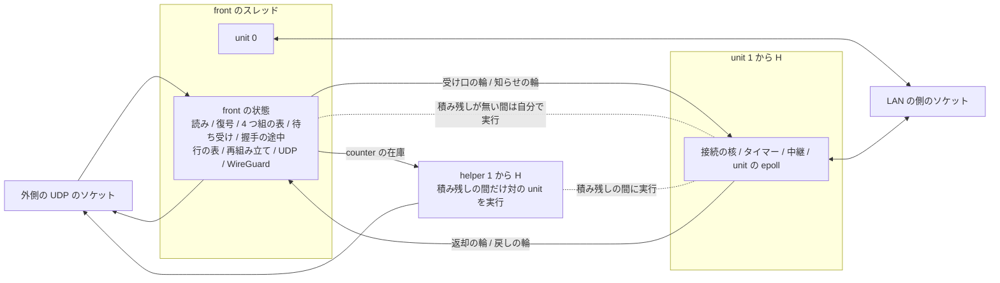

# 所有と同期の設計 (N2)

この文書は、推奨の構成 U で、状態ごとの持ち主、unit を実行する権利とその受け渡し、データの流れ、接続を unit に置く手順、同期の点とその頻度を定めます。
未採用の提案で、骨格までを定め、細部は実装と試作で決めます([提案の索引](README.md))。
試作で決める未決の項目は[未決の項目](verification.md#未決の項目)にまとめます。

## 所有の全体図

## 状態と実行の分け方

- unit は TCP の接続の状態の区画で、接続の核、タイマー、中継の状態、LAN の側のソケットを持ちます。
  接続は作成の時に unit に置かれ、閉じるまで動きません
- executor は unit を実行するスレッドです。
  front のスレッドと、H 本の helper のスレッドがあります
- unit の数は M = H + 1 です。
  unit 0 は常に front が実行し、unit i (1 から H) は helper i と対になります。
  積み残しの間も front は unit 0 を持つので、CPU が 2 つの時も送る向きの仕事が 2 つのスレッドに分かれます(設計判断)
- 各 unit の核は、今と同じく自分の状態だけを `&mut` で持つ値で、核の中に `unsafe`、錠、atomic を入れません
- front の状態は、外側のソケット、WireGuard のセッション (sanstun の `Tunnel`)、4 つ組の表、待ち受け、accept の待ち行列、握手の途中、TIME_WAIT と FIN_WAIT_2 の行、再組み立て、UDP です。
  front のスレッドだけが実行します
- どの unit をどの executor が実行しているかは、front だけが持つ表で決まります。
  受け渡しは front が始め、戻りは front が知らせで知るので、表は 1 つの持ち主の値です
- 利用できる CPU が 1 つの時は unit を分けず、front の核が今の核そのものです

## 積み残し

積み残しは、この提案で 1 つの意味だけに使います。

- 入る:front の起床が遅れの予算 (50 µs) を使い切り、その後にも外側のソケットにデータが残ることが、続けて 8 回起きた時です。
  1 回の起床は予算を最大でバッチ 1 つ分超えるので、入るまで約 0.6 ms です(推定)
- 渡す:積み残しの間、front は、自分の起床の時間の 10% 以上を使った unit を、重い順に起床ごとに 1 つずつ対の helper に渡します。
  front の起床が予算を使い切らなくなったら、渡すのを止めます。
  UDP や握手で front が詰まっている時は、渡す unit が無いので、TCP は front のままです
- 戻す:各 helper は 1 回の実行の終わりに、直近の忙しさの割合を自分の atomic に書きます。
  front は 100 ms ごとにそれを読み、front の忙しさと helper i の忙しさの和が 0.6 CPU を下回った unit i を 1 つ戻します
- 出る:すべての unit が front に戻った時です

入る判定は front が詰まったことを、戻す判定は戻した後の仕事が 1 つのスレッドに収まることを見るので、続く最大の負荷では出入りを繰り返しません。
値 (8 回、10%、0.6、100 ms) は仮の値で、続く最大の負荷で出入りが 1 秒に 1 回以下であることを P0 と P2 の関門で確かめます([関門](verification.md#段階の試作))。

## unit の受け渡し

### unit の epoll

各 unit は自分の epoll を持ち、LAN の側のソケットをそこに登録します。
executor の poller には unit の epoll の記述子だけを登録します。

- 受け渡しの費用:記述子 1 つの登録の付け替えで、ソケットの数によりません
- 準備の知らせ:ソケットの準備は unit の epoll に溜まり、executor が替わっても失われません
- 軽い負荷の費用:LAN の側の準備がある起床ごとに、unit の epoll を読む system call が 1 回加わります

### front から helper への受け渡し

1. front は、その起床の送りのバッチを送り終えた後に、unit i の epoll を自分の poller から外して helper i の poller に登録します
2. front は helper i の受け渡しの枠 (1 つの値を入れる箱) に、unit i の次のタイマーの期限を添えた受け取りの知らせを入れ、helper i が眠っていれば起こします
3. helper i は知らせを受けて unit i を実行します。
   受け口の輪の読み手は、2 の release と 3 の acquire で替わります

### helper から front への戻し

1. front は helper i の受け渡しの枠に戻しの求めを入れます
2. helper i は、unit i の 1 回の実行を終え、unit i の暗号化した datagram を送信の枠から送り終えた点で、unit i の epoll を front の poller に移し、戻しの知らせを枠に入れ、front が眠っていれば起こします
3. front は知らせを受けた後に unit i を実行します

送り終えてから渡すので、1 つの接続の datagram が古い持ち主と新しい持ち主から前後して出ることはありません。

### 止まった helper

helper が CPU を取られると、対の unit の仕事はその間待ちます。
front は unit の受け口の輪に載せ続け、平文の置き場の上限で unit の TCP の segment を捨てます([平文の置き場と unit の上限](memory.md#平文の置き場と-unit-の上限))。
front、UDP、ほかの unit は止まりません。
止まった unit には新しい接続を置きません。
止まった helper から unit を取り戻す手順は[未決の項目](verification.md#未決の項目)です。

### タイマー

各 unit は 1 回の実行の終わりに次の期限を自分の状態に書き、各 executor は自分が実行する unit の期限の最小でタイマーを張ります。
積み残しが無い間は front のタイマーだけが動き、helper は起きません。

## unit の選び方

接続を置く unit は、受動の open では握手の最後の ACK を受けた時に、能動の open では dial の時に、front が選びます。

- 重み:front は、受け口の輪に載せた packet の数を unit ごとに数え、100 ms ごとに半分にします
- 選ぶ unit:重みの最も小さい unit を選びます。
  同じなら生きている接続の少ない unit、それも同じなら番号の小さい unit です
- 外す unit:空きの枠が無い unit、平文の置き場の上限に達した unit、受け口の輪が空でないのに 10 ms 進んでいない unit を外します
- すべて外れた時:最後の ACK を捨てて握手の途中の行を残します。
  unit 0 は front が実行するので止まらず、すべてが外れるのは、どの unit にも空きの枠が無いか、上限に達した時だけです

重みは今の負荷しか見ないので、静かに張られて後で大きくなる接続は、作成の時には区別できません。
後で大きくなった 2 本が同じ unit に入ると、その 2 本は 1 つの helper を分けます。
この偏りは F の hash の偏りと同じ種類の制限で、[後で重くなる配置の試験](verification.md#測定の行列)で大きさを測ります。

## 接続を unit に置く手順

### 受動の open

1. front は、最後の ACK (または cookie の ACK) を受け、今と同じく accept の待ち行列の空きを確かめます
2. front は unit u と u の空きの枠 j を選びます。
   経路を確かめるのはこの時の 1 回で、相手のアドレスは接続の間変わりません
3. front は、交渉した値の組と最後の ACK の記述子を、作成の知らせとして u の知らせの輪に載せます
4. front は、4 つ組の表の項を (u、j、世代) に替え、握手の途中の行を消し、accept の待ち行列に (u、j、世代) を入れます
5. u は作成の知らせから接続を確立し、最後の ACK が運んだデータと FIN を今と同じく処理します

### 能動の open

front が一時ポートを選び、4 つ組の表で衝突を確かめて項を入れ、dial の知らせを u の知らせの輪に載せます。
u は SYN-SENT の接続を作り、SYN を送ります。
dial を求めるアプリケーションの側の道と完了の知らせは[未決の項目](verification.md#未決の項目)です。

### 置く時の競合

置く点は、front が 4 つ組の表の項を替える 1 回の操作です。

| 競合 | 扱い |
|---|---|
| SYN の再送 | 置いた後なら u の確立した接続に届き、今の核と同じく扱います |
| 最後の ACK の再送 | 置いた後なら u に届き、重複の ACK として扱います |
| 最後の ACK が運ぶデータ | 作成の知らせが記述子を運び、確立の直後に処理します |
| 最後の ACK の直後のデータ | u は知らせの輪を先に読み、知らない枠の記述子を見たら知らせの輪を読み直します |
| 置く前と後の RST | 置く前は front の握手の途中の行、置いた後は u の接続が今と同じく処理します |

## front と unit の間の知らせ

捨ててよいデータの記述子は受け口の輪で、捨ててはいけない知らせは別の輪で運びます。

| 輪 | 向き | 運ぶもの | 容量の決め方 |
|---|---|---|---|
| 受け口の輪 | front から unit | 記述子 | 上限 2,048 で、満ちたら TCP の segment を捨てます |
| 知らせの輪 | front から unit | 作成か dial、accept の後の中継の開始、待ち受けの Close による accept の前の接続の終わり、枠の中の TIME_WAIT の終わりの求め、停止 | 枠ごとの知らせの数の上界から決めます |
| 返却の輪 | unit から front | 4 つ組の表から外す (CLOSED の時か、行に移る時で行の中身を運びます)、枠の解放 | 同上 |
| 戻しの輪 | unit から front | front に渡す SYN (枠の中の TIME_WAIT への SYN と、表から外した後に届いた SYN) | 64。満ちたら SYN を捨てます |

今の核は、CLOSED になった時に 4 つ組の表と accept の待ち行列から外し、アプリケーションが閉じた時に枠を返します (`crates/wgft-wgstack/src/tcp/ctx.rs` の `enter_closed`)。
U でも同じ時機に知らせを出すので、RST を受けた後の同じ 4 つ組の新しい SYN は、今と同じく待ち受けに届きます。

知らせの輪と返却の輪の容量の証明には、まだ足りない知らせの源 (ルールの変更による accept した接続の終わり、DNS と dial の結果、古い handle の `abort` による行の削除) と、枠を使い直す時の重なりが残ります([未決の項目](verification.md#未決の項目))。
容量を超えた時は、捨てずに engine の毒の印を立てて世代を終えます(設計判断)。

枠の中の TIME_WAIT への SYN は、u が RFC 6191 の番号と timestamp の条件を確かめ、満たせば SYN と TIME_WAIT の値を戻しの輪で front に渡します。
front は待ち受けと握手の途中の空きを確かめ、受け入れるなら u に枠の中の TIME_WAIT の終わりを求めてから握手の途中の行を作り、受け入れないなら渡された値から TIME_WAIT の ACK を送ります。
今の核の使い直しと同じ出力です。

## 受ける向きのデータの流れ

1. front はバッチを読み、datagram の順に今の `Device::handle_datagram` の 1 回の呼び出しで復号します
2. UDP はその場で処理します
3. TCP の記述子を unit の受け口の輪に載せます
4. unit を front が実行しているなら同じ起床の中で実行し、helper が実行しているなら起床ごとに 1 回公開して、helper が眠っていれば起こします
5. unit は処理を終えた平文の参照を返します

## 送る向きと counter

- front が実行する unit:front は今の `Device::handle_packet` の 1 回の呼び出しで暗号化し、その起床で実行した全 unit の datagram と UDP を 1 つの送りのバッチにまとめます
- helper が実行する unit:helper は front から受けた counter の在庫で暗号化し、自分で送ります

### counter の在庫

front だけが `Tunnel` を `&mut` で持ちます。
helper の暗号化には、front が `begin_encapsulate` で作る `PendingEncapsulate` (鍵の写し、受け手の index、counter) を使います。
`PendingEncapsulate` の欄は `Zeroizing` の鍵、index、`u64` だけなので、スレッドの間で渡せます (sanstun のコードの読み)。

- 在庫:helper ごとに 64 までの在庫を持ちます。
  front は自分が起きた時に、半分を下回った在庫を 64 まで補充します
- 在庫が尽きた時:helper は求めの印を立て、front が眠っていれば起こします。
  front は求めの印を起床の理由として扱い、補充して helper を起こします。
  タイマーで送る再送 (RTO、TLP) も同じ道を通るので、ほかの出来事を待ちません
- 費用:front が眠っていた時の補充は、起床 2 回 (front と helper) で、64 datagram ごとに数 µs の CPU です(推定)
- 古い counter:helper は暗号化の前に、front が補充ごとに公開する (受け手の index、最新の counter) と比べ、同じ index で 4,064 より遅れた counter を捨てて数えます。
  4,064 は相手の窓 8,128 の半分です([WireGuard の仕様との違い](../../v2/wireguard-device.md#wireguard-の仕様との違い))。
  暗号化した後の遅れは直さず、相手が捨てた分は TCP が再送します
- endpoint:front は endpoint を変えるたびに世代を進め、helper は古い世代の在庫を捨てます
- セッションが無い時:front は補充できない求めを受けると、今の `handle_packet` と同じくデータによるハンドシェイクの開始を行います。
  helper は在庫が無い間は核から引かず、補充の時に起こされます
- 送った数と keepalive の期限:helper は送った数を自分の atomic に足し、front は起床ごとにそれを読んで、ピアの送った数と persistent keepalive の期限を進めます
- sanstun のタイマー:`begin_encapsulate` は送った時刻を記録し、wgft の passive keepalive の期限を解きます。
  使わずに捨てた在庫 (戻しの時と、古い counter) はこの記録だけを残し、keepalive が出ないことや handshake の開始が早まることがありえます。
  データは失いません。
  捨てる在庫は helper ごとに 64 以下です

### UDP と helper の送り

積み残しの間、helper の TCP の送りと front の UDP は同じ外側のソケットに送ります。
UDP を TCP の大きな送りの後ろに並べない規則を、次の 2 つで守ります(設計判断)。

- 先送りの印:front は UDP を送る前に印を立て、送った後に下ろします。
  helper は `sendmmsg` の前に印を見て、立っている間は送りを待ちます
- 送りの上限:front が直近 10 ms に UDP を送った間、helper の 1 回の `sendmmsg` の byte を B / H に抑えます。
  B は Inline の 1 回の送りのバッチの最大の byte です

この 2 つで、UDP の datagram の前に helper が出せる byte は Inline の 1 バッチ分 (B) までです。
カーネルの送信の待ち行列にすでにある分は、Inline と同じく wgft の外です。
費用 (system call の増え方) と UDP の遅れは、最大の送る負荷の試験で測ります。

## 同期の点と頻度

頻度は、積み残しの間の 1 Mpps (MTU 1,420 で約 11 Gbit/s) の推定です。
積み残しが無い間は、front のスレッドが全部を実行するので、下の点はほかのスレッドと競いません。

| 同期の点 | 方法 | 頻度 |
|---|---|---|
| 受け口の輪、知らせの輪、返却の輪、戻しの輪 | SPSC。index の公開は起床ごとに 1 回 | 起床ごとか接続ごと |
| 受け渡しの枠 (helper ごと) | 1 つの値の箱 | 積み残しの出入り |
| 忙しさの割合 (helper ごと) | atomic。helper が書き、front が 100 ms ごとに読みます | 実行ごとに書きます |
| counter の在庫と求めの印 | SPSC と atomic の印 | 64 datagram ごと |
| 最新の counter と endpoint の世代 | front が書く atomic | 補充ごと |
| 送った数 (helper ごと) | atomic の足し算 | 送りのバッチごと |
| UDP の先送りの印 | front が書き、helper が `sendmmsg` の前に読みます | 送りごと |
| challenge ACK の速さ | engine で 1 つの atomic の bucket。front が 1 秒ごとに足し、unit が送る時に引きます | 攻撃の時だけ |
| 起こす知らせ | 相手の眠りの印を見て、眠っている時だけ起こします | 公開ごと |
| 予算の credit | 全体の空きの数への CAS | 1 MiB の credit ごと |
| 毒の印 (panic) | engine で 1 つの atomic の bool。立てた executor が全 executor を起こします | panic の時 |

データの経路に錠はありません。
agent には、接続ごとに取る錠が今も残ります。
フローの数の予算 (`flowpool` の `Arc<Mutex>`、接続の開始と終わり)、宛先と名前の解決の表 (`targets` と `resolve`、dial と名前の解決ごと)、中継のログの門 (ログの行ごと) です。
U ではこれらを helper のスレッドも取るので、取る頻度は接続の作成の速さと同じです。

## TCP の接続の持ち主と状態の移り

| 状態 | 置き場 | 持ち主 |
|---|---|---|
| LISTEN、SYN-RCVD | 待ち受けの表、握手の途中の行か cookie | front |
| SYN-SENT から LAST-ACK、枠の中の FIN_WAIT_2 と TIME_WAIT | 接続の枠 | 作成の時の unit |
| accept の前の ESTABLISHED | 接続の枠と、front の accept の待ち行列の項 | unit (待ち行列の項は front) |
| FIN_WAIT_2 と TIME_WAIT の行 | 行の表 | front |

状態機械の移りは今の核と同じです。
接続の状態の持ち主が変わるのは、握手の最後と行に移る時の 2 点だけで、どちらも接続がデータを持たない点です。
行に移った後に、front が表を替える前に u に届いた FIN、RST、データの扱いは[未決の項目](verification.md#未決の項目)です。

## そのほかの状態

- 待ち受けと accept:front の核が今と同じく行います。
  accept した接続のアプリケーションは、その接続の unit で始めます
- dial と一時ポート:front が選び、4 つ組の表で衝突を確かめます。
  確かめは 1 つのスレッドの論理のままです
- UDP:endpoint とセッションは front が持ち、スレッドを移りません。
  大きな量の UDP は front の 1 つの CPU に収まる分までです
- 再組み立て:front が持ち、今の 1 秒ごとの掃除 (128 個までの項目) をそのまま使います。
  組み立てた datagram は続く平文の block にまたがって写し、受け口の輪で unit に渡します
- ICMP:受けた誤りは front が引用の 4 つ組で unit を引いて渡し、echo、ping、送る ICMP の誤りは front が持ちます
- タイマー:接続のタイマーは unit の核にあり、握手の途中、行、再組み立て、WireGuard のタイマーは front にあります
- 数え:unit の数えは unit の持ち主の値で、読む時は front が知らせで写しを求めます

## スレッドの間の packet の順

1. 受ける向き:front は datagram を読んだ順に復号し、同じ順に振り分けます
2. 受ける向き:1 つの接続の packet は、すべて同じ unit の 1 つの受け口の輪に入ります
3. 置く点:作成の知らせは、その接続のどの記述子より先に公開されます
4. 送る向き:1 つの接続の segment は unit の持ち主だけが作り、作った順に送ります。
   受け渡しは古い持ち主が unit の datagram を送り終えた後に行います

## TCP の状態機械が保たれる理由

確立した後の TCP の接続の状態を読み書きするのは、その unit を実行する 1 つのスレッドだけです。
実行するスレッドが替わる時は、前のスレッドが実行を終えて datagram を送り終えた点で替わり、受け渡しの release と acquire が状態の見え方をつなぎます。
このため、1 本の接続から見た入力の列 (packet、タイマー、操作) は、利用できる CPU が 1 つの時と同じ種類と同じ順の列です。
握手の途中から確立への移りは、dial の設計が決めた、交渉した値の組から始める 1 つの入口を通ります([受動と能動の open に共通の TCP の状態の模型](api.md#受動と能動の-open-に共通の-tcp-の状態の模型))。
接続の状態機械に見える変更は、段 (需要で育つバッファの、受信と送信の予約の大きさの段) を大きくできるかが unit の credit と全体の予算で決まることだけです。

## 今との違い

利用できる CPU が 2 つ以上の時に、今の核と出力が違いうる点は次のとおりです。

| 違い | 起きる時 |
|---|---|
| 平文の置き場の上限で TCP の segment を捨てます | helper が止まり、unit の上限に達した時 |
| 戻しの輪が満ちたら SYN を捨てます | front が詰まり、戻す SYN が 64 を超えた時 |
| 最後の ACK を捨てます | どの unit にも空きの枠が無いか、すべてが上限に達した時 |
| 回収した予算を、求めた接続より先に別の unit の接続が取ることがあります | 全体の予算が尽きた時。需要で育つバッファの設計は直接渡すと決めています([需要で育つバッファ](../../userspace/wgstack-buffers.md#育つ条件)) |

## ワーカーの停止と再起動

- 停止:front が各 unit に知らせの輪で停止を知らせ、各 unit の実行者が接続を閉じ、予算を返してから終わります
- panic と輪の溢れ:engine の毒の印を立て、立てた executor が全 executor を起こし、世代を終えます。
  1 つの unit だけを作り直すことはしません
- 世代の受け渡し:全体の予算と置き場は、今の `Budget` と同じく次の世代に渡します

## device とネットワークの I/O の持ち主

| I/O | 持ち主 |
|---|---|
| 外側のソケットの読み | front |
| 外側のソケットへの送り | front と、積み残しの間の helper |
| device の層の送る datagram (ハンドシェイク、cookie、keepalive) | front。データより先に送る今の規則を保ちます |
| LAN の側の TCP のソケット | unit。unit の epoll に登録します |
| LAN の側の UDP のソケット | front |
| 名前の解決のスレッド | 今と同じく別のスレッド |
| 制御プレーンからの命令 | front が受けます |

## 今の Shared の欄の新しい持ち主

今の核の `Shared` (`crates/wgft-wgstack/src/stack/shared.rs`) の欄の持ち主です。

| 欄 | 新しい持ち主と形 |
|---|---|
| `config`、`addr`、`isn_key`、`ts_key`、`cookie_key` | front と各 unit の読み取り専用の写し。unit の番号と M を加えます |
| `now` | front と unit ごと。プロセスで 1 つの起点の時計から、実行する executor が読みます |
| `ip_id` | front と unit ごと。M + 1 おきの重ならない値を使います。利用できる CPU が 1 つなら今と同じです |
| `rng` | front と unit ごと。種は全体の種と番号から導き、front は今と同じ種です |
| `conn_free` | front が unit ごとに持ちます。解放の知らせで戻ります |
| `qlinks`、`queued`、`conn_idx` | front。項は (unit、枠、世代) です |
| `syn`、`tw`、`listeners`、`cookie_sent` | front |
| `out`、`events`、`wheel`、`fired` | front と unit ごと。ポートの知らせは front だけが持ちます |
| `chunks` | front と unit ごと([chunk と大きいバッファの置き場](memory.md#chunk-と大きいバッファの置き場)) |
| `frag`、`frag_next_sweep`、`udp`、`pings`、`icmp_sec`、`icmp_count` | front |
| `budget` | 全体の予算と unit ごとの credit。保有者の list と回収は unit ごと |
| `ch_sec`、`ch_count` | engine で 1 つの atomic の bucket。今と同じ全体の上限です |
| `stats`、`gates` | front と unit ごと。読む時は front が写しを集めます |
| `ConnSlots` の `with_arrays`、`hook` | unit ごと。表の行の数は unit の枠の数です |

[提案の索引](README.md)
